# PenniLogic journey and service blueprints

<!-- Generated by scripts/check_journeys.py --write-summary from product/journey-blueprints.json and product/journey-gaps.json; do not edit. -->

Blueprint version 0.1.0 (provisional) for PenniLogic/docs#67 (T-UXR-04). Readiness: NOT GREEN: readiness incomplete.

Registry pin: commit 1722fc79ab2abee15d3adc2ed2f3baaad4bd6ed4, path planning/source/evidence/experience-coverage.json, sha256:2f7b27c1f6683d4c256a938ccfb0fc06614f83fe57996a4d7aeaf0b7cae0bf3a.

Personas are planning hypotheses, not research evidence: every persona basis stays provisional until PenniLogic/docs#66 evidence exists. Metric references stay pending on PenniLogic/docs#77 and event references pending on their owner issues. Diagrams here are markdown text renderings; a Figma page named by the registry is held, and a diagram whose registry artifact is a Git file has none. No approval, review, tabletop or backlog issue is recorded by this file.

Step data classes (public, internal, confidential, restricted) are a provisional scale proposed here: personal-data classification belongs to the T-CMP-04 jurisdiction profile (PenniLogic/docs#44, ADR-020 section 15), which confirms or replaces it (GAP-J10-03).

The readiness verdict is NOT GREEN by construction: the checker holds every human input (approvals, research, persona validation, backlog items, gap resolution), the registry pin, pending metric and event references and the Figma state, so GREEN needs a later change to the checker and its schema, not only new inputs. Identifier continuity against an earlier published revision is not checked (readiness.continuity_unchecked).

## Readiness gaps

| Rule | Count | Subjects |
|---|---|---|
| readiness.registry_unintegrated | 1 | PenniLogic/docs#75 |
| readiness.research_pending | 1 | PenniLogic/docs#66 |
| readiness.persona_provisional | 12 | J01, J02, J03, J04, J05, J06, J07, J08, J09, J10, J11, J12 |
| readiness.approval_pending | 5 | architecture, ia, operations, product, security |
| readiness.review_pending | 2 | boundary_review, tabletop |
| readiness.metric_pending | 12 | J01, J02, J03, J04, J05, J06, J07, J08, J09, J10, J11, J12 |
| readiness.event_pending | 33 | J01.T.02, J01.T.03, J03.T.02, J03.T.03, J03.T.04, J03.T.05, J04.T.01, J04.T.02, J05.T.01, J05.T.02, J05.T.03, J06.T.01, J06.T.02, J06.T.03, J06.T.04, J06.T.05, J07.T.01, J07.T.02, J07.T.03, J07.T.04, J08.C.04, J08.T.01, J08.T.03, J09.T.01, J09.T.02, J09.T.03, J10.T.01, J10.T.04, J10.T.06, J10.T.08, J11.T.04, J11.T.06, J12.T.02 |
| readiness.gap_open | 19 | GAP-J01-01, GAP-J01-02, GAP-J01-03, GAP-J02-01, GAP-J02-02, GAP-J03-01, GAP-J05-01, GAP-J06-01, GAP-J07-01, GAP-J07-02, GAP-J07-03, GAP-J09-01, GAP-J10-01, GAP-J10-02, GAP-J10-03, GAP-J11-01, GAP-J11-02, GAP-J12-01, GAP-J12-02 |
| readiness.gap_backlog_missing | 19 | GAP-J01-01, GAP-J01-02, GAP-J01-03, GAP-J02-01, GAP-J02-02, GAP-J03-01, GAP-J05-01, GAP-J06-01, GAP-J07-01, GAP-J07-02, GAP-J07-03, GAP-J09-01, GAP-J10-01, GAP-J10-02, GAP-J10-03, GAP-J11-01, GAP-J11-02, GAP-J12-01, GAP-J12-02 |
| readiness.figma_held | 4 | D03, D04, D05, D21 |
| readiness.continuity_unchecked | 1 | PenniLogic/docs#67 |

Drift of the live registry from the pin (readiness.registry_id_added, readiness.registry_id_retired, readiness.registry_record_changed) is reported by the default mode only, never by this file.

## Approvals and research gate

| Role | Status |
|---|---|
| product | pending |
| architecture | pending |
| security | pending |
| operations | pending |
| ia | pending |

| Review | Status |
|---|---|
| tabletop | not_run |
| boundary_review | not_run |

Research gate PenniLogic/docs#66: pending, 0 evidence records.

## Diagram renderings

| Diagram | Rendering | Figma |
|---|---|---|
| D01 | markdown_text | not_applicable |
| D03 | markdown_text | held |
| D04 | markdown_text | held |
| D05 | markdown_text | held |
| D21 | markdown_text | held |

### D01 experience ecosystem (text rendering)

```mermaid
flowchart LR
    channel_admin["admin channel"]
    channel_android["android channel"]
    channel_notification["notification channel"]
    channel_service["service channel"]
    channel_web["web channel"]
    system_access_broker["access-broker"]
    system_admin_api["admin-api"]
    system_admin_console["admin-console"]
    system_ai_gateway["ai-gateway"]
    system_android_app["android-app"]
    system_android_capture["android-capture"]
    system_api_ai_tools["api-ai-tools"]
    system_api_consent["api-consent"]
    system_api_debt_engine["api-debt-engine"]
    system_api_entitlements["api-entitlements"]
    system_api_household["api-household"]
    system_api_identity["api-identity"]
    system_api_import["api-import"]
    system_api_ledger["api-ledger"]
    system_api_messaging["api-messaging"]
    system_api_net_worth["api-net-worth"]
    system_api_planning["api-planning"]
    system_api_rights["api-rights"]
    system_api_sharing["api-sharing"]
    system_api_split_ledger["api-split-ledger"]
    system_api_support["api-support"]
    system_api_sync["api-sync"]
    system_audit_trail["audit-trail"]
    system_notification_outbox["notification-outbox"]
    system_web_app["web-app"]
    channel_admin --> system_admin_console
    channel_android --> system_android_app
    channel_notification --> system_notification_outbox
    channel_service --> system_access_broker
    channel_service --> system_admin_api
    channel_service --> system_ai_gateway
    channel_service --> system_android_capture
    channel_service --> system_api_ai_tools
    channel_service --> system_api_consent
    channel_service --> system_api_debt_engine
    channel_service --> system_api_entitlements
    channel_service --> system_api_household
    channel_service --> system_api_identity
    channel_service --> system_api_import
    channel_service --> system_api_ledger
    channel_service --> system_api_messaging
    channel_service --> system_api_net_worth
    channel_service --> system_api_planning
    channel_service --> system_api_rights
    channel_service --> system_api_sharing
    channel_service --> system_api_split_ledger
    channel_service --> system_api_support
    channel_service --> system_api_sync
    channel_service --> system_audit_trail
    channel_web --> system_web_app
```

### D03 current and target journey map set (text rendering)

| Blueprint | Journey | Audience | Current map | Target map | Success | Failure recovery |
|---|---|---|---|---|---|---|
| BP-J01 | J01 | customer | Planned baseline from product/08 and the registry: launch, sign-up, consent and debt entry are separate flows with no shared failure path. | One first-run journey from launch to a confirmed debt-free date, with optional capture access and a web continuation that reuses the same server-derived schedule. | A new customer reaches a server-derived debt-free date on Android and sees the same status on web. | Any failed step keeps manual setup usable and returns the last confirmed schedule with a stale marker instead of a locally computed figure. |
| BP-J02 | J02 | customer | Planned baseline: sign-in, recovery and session screens exist per platform in the registry without a shared recovery state model. | One return journey across Android and web where recovery is slow by design, cancellable by the real owner and visible on every enrolled device. | A returning customer signs in with a passkey on Android or web and reviews active sessions. | A lost passkey goes through one of the two ADR-019 recovery routes with cooling off, all-device notification, a cancellation path and a restricted period afterwards. |
| BP-J03 | J03 | customer | Planned baseline from product/08 section 9.1: on-device capture, sync and clarification are drawn as one sequence for Android only. | Capture, manual entry, receipts and statement import share one confirmation and correction path across Android and web, and raw message text never leaves the device. | A captured, entered or imported transaction becomes a confirmed ledger transaction with provenance that the customer can correct on Android or web. | Unparsed, duplicate, conflicting or rejected items land in clarification with coded reasons; corrections post new entries and rules roll back without rewriting history. |
| BP-J04 | J04 | customer | Planned baseline: strategy, simulator and advanced scenario screens per platform, with derivation shown on web only. | One decision journey where every figure is server-derived and explainable, and a chosen plan is versioned rather than overwritten. | The customer compares strategies, chooses one and sees the re-derived debt-free date on both platforms. | Incomplete debt terms are named and fixed in place; offline comparison stays read-only and stale-marked; a previous plan version can be restored. |
| BP-J05 | J05 | customer | Planned baseline: income, budget, goal, net-worth and multi-currency screens are separate registry flows per platform. | One planning journey where budgets, safe to spend, net worth and reporting-currency totals are derived on the server and stay per currency unless a dated rate exists. | The customer sets income, budgets and a goal and sees net worth and reports that agree on Android and web. | Missing income dates give a ranged result that names the gap; slow derivation shows the last confirmed values; a missing exchange rate shows per-currency totals only. |
| BP-J06 | J06 | customer | Planned baseline: split group, allocation, settlement, dispute and invitation screens per platform with no shared clock or reversal model. | One sharing journey with single-use invites, server-derived shares, append-only settlement history and a member exit that keeps the facts others depend on. | A group is created, invitees accept, expenses are allocated and every member settles to a zero balance. | Unsent or expired invites can be resent; partial settlements stay open and visible; disputes stay open until the organiser decides, with every change as a new entry. |
| BP-J07 | J07 | customer | Planned baseline from product/08 section 9.2: the household grant state machine from private to revoked and evicted, without channel or service ownership. | The same state machine as a cross-channel blueprint with explicit aggregate and detail consents, an access log, safe exit and a server-enforced eviction path. | A household shares only the aggregates each member granted, tracks a joint goal, and any member can leave safely at any time. | Declined or expired invites share nothing; after revocation server reads stop within the published online bound and cached data is evicted by the offline lease bound; safe exit needs no one else's approval. |
| BP-J08 | J08 | customer | Planned baseline: assistant answer, draft and history screens per platform with the AI egress path decided in ADR-022 but not drawn as a journey. | One assistant journey where scope comes from the server session, every remote call leaves through the egress proxy and nothing posts without the customer's confirmation. | The customer gets a cited explanation and, if they choose, confirms a draft that posts as a normal transaction with AI provenance. | Quota, provider or tool failures refuse explicitly with a retry or plan path; a posted draft is reversed like any transaction; history can be turned off or erased. |
| BP-J09 | J09 | customer | Planned baseline: purchase, preference, retention and billing portal screens per platform with entitlement rules in ADR-007 and ADR-023. | One billing and messaging journey where entitlement is resolved only on the server against a pinned plan version and every notice respects the customer's preferences. | The customer buys or changes a plan, sees the server-resolved entitlement and controls which notices and digests they receive. | Unverified purchases grant nothing and stay pending; undeliverable notices retry without duplicates; cancellations can be undone before the period boundary. |
| BP-J10 | J10 | customer | Planned baseline from product/08 section 9.3: rights request and operator fulfillment as one flow, with support and refunds in separate registry flows. | One trust journey joining the customer trust centre, rights and support requests and the redacted operator queues, with clocks, audit, notices and reversal on every consequential step. | A customer's export, deletion or support request is validated, fulfilled by a qualified operator on redacted data and closed with a notice inside its clock. | Every request is acknowledged and its clock runs from acknowledgement; an unverifiable request ends in a reasoned refusal; requests near breach are escalated; refusals carry reasons and a way to contest; shared records keep placeholder facts. |
| BP-J11 | J11 | operator | Planned baseline: operator sign-in, redaction and elevation, lifecycle, rights fulfillment and production access are separate admin flows under ADR-020. | One operator journey from sign-in to fulfilled request where every access is purpose-bound, approved by someone else, expiring and audited before data is read. | Operators reach only the work their role allows, gain detail or production access only through independent, expiring approval, and close rights requests inside their clock. | Denied or expired requests grant nothing; break glass is reviewed after the fact; a restore that fails the scrub barrier is discarded; a leaver's revoked session is denied on its next request. |
| BP-J12 | J12 | operator | Planned baseline: plan, AI provider, audit and incident admin flows as separate registry entries with no customer-facing consequence drawn. | One configuration and release journey where every change is versioned, audited and visible to the customers it affects before it takes effect. | Plan, provider and spend changes reach customers without silent impact, and audit, incident and release evidence is complete before release. | Invalid plan versions are never published; migrations are reversible until their boundary; the kill switch refuses new remote AI calls at admission and stops in-flight traffic within the ADR-022 60-second bound; a failed retest blocks release. |

### D21 critical journey task flow and wireflow index (text rendering)

| Journey | Flow | Steps | Screens |
|---|---|---|---|
| J01 | F-AND-01 | J01.C.01 | S-AND-001, S-AND-002, S-AND-003 |
| J01 | F-AND-02 | J01.C.02 | S-AND-004, S-AND-005 |
| J01 | F-AND-03 | J01.C.03 | S-AND-009, S-AND-010, S-AND-011, S-AND-012 |
| J01 | F-AND-04 | J01.C.04, J01.C.05 | S-AND-014, S-AND-015, S-AND-016, S-AND-017 |
| J01 | F-AND-16 | J01.C.06 | S-AND-059, S-AND-060 |
| J01 | F-WEB-01 | J01.C.07 | S-WEB-001, S-WEB-003, S-WEB-004, S-WEB-042 |
| J01 | F-WEB-03 | J01.C.08 | S-WEB-010, S-WEB-011 |
| J02 | F-AND-02 | J02.C.01, J02.C.02, J02.C.03, J02.C.05, J02.C.06 | S-AND-004, S-AND-006, S-AND-007, S-AND-008, S-AND-064 |
| J02 | F-WEB-01 | J02.C.07, J02.C.08 | S-WEB-001, S-WEB-002, S-WEB-003, S-WEB-044 |
| J03 | F-AND-03 | J03.C.01 | S-AND-011, S-AND-012, S-AND-013 |
| J03 | F-AND-06 | J03.C.03, J03.C.05 | S-AND-021, S-AND-022, S-AND-023, S-AND-024, S-AND-025 |
| J03 | F-AND-07 | J03.C.02, J03.C.06 | S-AND-028, S-AND-029, S-AND-030, S-AND-031, S-AND-065 |
| J03 | F-AND-08 | J03.C.04 | S-AND-032, S-AND-033, S-AND-034 |
| J03 | F-WEB-02 | J03.C.08, J03.C.09 | S-WEB-005, S-WEB-006, S-WEB-007, S-WEB-008 |
| J03 | F-WEB-05 | J03.C.07 | S-WEB-015, S-WEB-016, S-WEB-045, S-WEB-046 |
| J04 | F-AND-04 | J04.C.01, J04.C.04, J04.C.08 | S-AND-014, S-AND-015, S-AND-016, S-AND-017 |
| J04 | F-AND-05 | J04.C.02, J04.C.03 | S-AND-018, S-AND-019, S-AND-020 |
| J04 | F-WEB-03 | J04.C.05, J04.C.07 | S-WEB-010, S-WEB-011, S-WEB-012 |
| J04 | F-WEB-04 | J04.C.06 | S-WEB-013, S-WEB-014 |
| J05 | F-AND-09 | J05.C.01, J05.C.02 | S-AND-035, S-AND-036, S-AND-037 |
| J05 | F-AND-10 | J05.C.03 | S-AND-038, S-AND-039, S-AND-040, S-AND-041 |
| J05 | F-AND-16 | J05.C.04 | S-AND-059, S-AND-060 |
| J05 | F-WEB-06 | J05.C.05 | S-WEB-017, S-WEB-018, S-WEB-019, S-WEB-020, S-WEB-021 |
| J05 | F-WEB-12 | J05.C.06, J05.C.07 | S-WEB-038, S-WEB-039 |
| J06 | F-AND-11 | J06.C.01, J06.C.04, J06.C.05 | S-AND-042, S-AND-043, S-AND-044, S-AND-045 |
| J06 | F-WEB-07 | J06.C.03, J06.C.06 | S-WEB-022, S-WEB-023, S-WEB-024, S-WEB-040 |
| J07 | F-AND-12 | J07.C.01, J07.C.03, J07.C.04, J07.C.05 | S-AND-046, S-AND-047, S-AND-048, S-AND-049 |
| J07 | F-WEB-08 | J07.C.02, J07.C.06 | S-WEB-025, S-WEB-026, S-WEB-027, S-WEB-041 |
| J08 | F-AND-13 | J08.C.01, J08.C.02, J08.C.03, J08.C.04 | S-AND-050, S-AND-051, S-AND-052 |
| J08 | F-WEB-09 | J08.C.05 | S-WEB-028, S-WEB-029, S-WEB-030 |
| J09 | F-AND-14 | J09.C.01, J09.C.02, J09.C.03 | S-AND-053, S-AND-054, S-AND-055 |
| J09 | F-WEB-10 | J09.C.05, J09.C.06 | S-WEB-031, S-WEB-032, S-WEB-033 |
| J10 | F-AND-15 | J10.C.01, J10.C.02 | S-AND-056, S-AND-057, S-AND-058, S-AND-063 |
| J10 | F-WEB-11 | J10.C.04, J10.C.05 | S-WEB-034, S-WEB-035, S-WEB-036, S-WEB-037, S-WEB-043 |
| J10 | F-ADM-06 | J10.T.07, J10.T.08 | S-ADM-015, S-ADM-016, S-ADM-017 |
| J10 | F-ADM-07 | J10.T.02, J10.T.03, J10.T.05 | S-ADM-018, S-ADM-019, S-ADM-020 |
| J11 | F-ADM-01 | J11.T.01, J11.T.02 | S-ADM-001, S-ADM-002, S-ADM-003, S-ADM-030 |
| J11 | F-ADM-02 | J11.T.03, J11.T.05 | S-ADM-004, S-ADM-005, S-ADM-006 |
| J11 | F-ADM-03 | J11.T.07 | S-ADM-007, S-ADM-008, S-ADM-009 |
| J11 | F-ADM-07 | J11.T.06 | S-ADM-018, S-ADM-019, S-ADM-020 |
| J11 | F-ADM-09 | J11.T.08, J11.T.10 | S-ADM-024, S-ADM-025, S-ADM-026 |
| J12 | F-ADM-04 | J12.T.01, J12.T.03 | S-ADM-010, S-ADM-011, S-ADM-012 |
| J12 | F-ADM-05 | J12.T.04 | S-ADM-013, S-ADM-014 |
| J12 | F-ADM-08 | J12.T.06 | S-ADM-021, S-ADM-022, S-ADM-023 |
| J12 | F-ADM-10 | J12.T.07, J12.T.08 | S-ADM-027, S-ADM-028, S-ADM-029 |

D04 and D05 are the text renderings of the blueprints that list them below.

## Blueprints

### BP-J01 First run to first debt-free status

- Journey J01, customer audience; personas P01, P03, P04 (provisional, pending:PenniLogic/docs#66).
- Flows: F-AND-01, F-AND-02, F-AND-03, F-AND-04, F-AND-16, F-WEB-01, F-WEB-03. Diagrams: D01, D03, D21. Policy class: none.
- Success: A new customer reaches a server-derived debt-free date on Android and sees the same status on web.
- Failure recovery: Any failed step keeps manual setup usable and returns the last confirmed schedule with a stale marker instead of a locally computed figure.
- Metric: pending:PenniLogic/docs#77
- Current map (planned_baseline): Planned baseline from product/08 and the registry: launch, sign-up, consent and debt entry are separate flows with no shared failure path.
- Target map (supersedes BP-J01.current_map): One first-run journey from launch to a confirmed debt-free date, with optional capture access and a web continuation that reuses the same server-derived schedule.

Moments of truth:

- J01.C.03: Declining optional capture access still leads to a working manual setup.
- J01.C.05: The first payoff date is server-derived and labelled with its as-of time.

```mermaid
flowchart LR
    subgraph customer[customer lane]
        J01_C_01["J01.C.01 android: Launches the app and passes the update check and the optional app lock"]
        J01_C_02["J01.C.02 android: Registers a passkey and verifies a contact channel"]
        J01_C_03["J01.C.03 android: Gives purpose consent, confirms age eligibility and chooses optional capture permissions"]
        J01_C_04["J01.C.04 android: Adds first debts manually and edits their terms"]
        J01_C_05["J01.C.05 android: Sees the debt-free home with the payoff date, schedule and widget"]
        J01_C_06["J01.C.06 android: Sees degraded-resource recovery or the widget with the last confirmed date"]
        J01_C_07["J01.C.07 web: Signs in on web with a passkey and opens the overview"]
        J01_C_08["J01.C.08 web: Reviews the debt dashboard and strategy comparison"]
    end
    subgraph team[team lane]
        J01_T_01["J01.T.01 service: Creates the account, binds the device session and records the verified channel"]
        J01_T_02["J01.T.02 service: Records purpose consent and age eligibility against the account"]
        J01_T_03["J01.T.03 service: Derives balances, payoff schedule and debt-free date from ledger entries"]
    end
    J01_C_01 --> J01_C_02
    J01_C_02 --> J01_T_01
    J01_T_01 --> J01_C_03
    J01_C_03 --> J01_T_02
    J01_C_03 -. permission_denied .-> J01_C_04
    J01_T_02 --> J01_C_04
    J01_T_02 -. offline .-> J01_C_04
    J01_C_04 --> J01_T_03
    J01_T_03 --> J01_C_05
    J01_T_03 -. timeout .-> J01_C_06
    J01_T_03 -. partial .-> J01_C_04
    J01_C_05 --> J01_C_07
    J01_C_06 --> J01_C_05
    J01_C_07 --> J01_C_08
```

| Step | Lane | Channel | System | Actor | Action | Flow | Screens | Data | Authorization | Events | Policies | Signal |
|---|---|---|---|---|---|---|---|---|---|---|---|---|
| J01.C.01 | customer | android | android-app | Customer (provisional persona) | Launches the app and passes the update check and the optional app lock | F-AND-01 | S-AND-001, S-AND-002, S-AND-003 | internal | Unauthenticated device; the app lock is local only | none | none | abandonment |
| J01.C.02 | customer | android | android-app | Customer (provisional persona) | Registers a passkey and verifies a contact channel | F-AND-02 | S-AND-004, S-AND-005 | confidential | Unauthenticated; passkey ceremony with user verification | none | ADR-019 | none |
| J01.T.01 | team | service | api-identity | Identity service in the core API | Creates the account, binds the device session and records the verified channel | none | none | restricted | Passkey attestation and device-bound session | none | ADR-019 | none |
| J01.C.03 | customer | android | android-app | Customer (provisional persona) | Gives purpose consent, confirms age eligibility and chooses optional capture permissions | F-AND-03 | S-AND-009, S-AND-010, S-AND-011, S-AND-012 | confidential | Signed-in owner on a device-bound session | none | ADR-004, ADR-011 | none |
| J01.T.02 | team | service | api-consent | Consent ledger in the core API | Records purpose consent and age eligibility against the account | none | none | confidential | Signed-in owner; server-side purpose registry | pending:PenniLogic/contracts#14 | none | none |
| J01.C.04 | customer | android | android-app | Customer (provisional persona) | Adds first debts manually and edits their terms | F-AND-04 | S-AND-015, S-AND-017 | confidential | Signed-in owner on a device-bound session | none | none | correction |
| J01.T.03 | team | service | api-debt-engine | Debt engine in the core API | Derives balances, payoff schedule and debt-free date from ledger entries | none | none | confidential | Signed-in owner; tenancy-scoped query | pending:PenniLogic/contracts#5 | ADR-001, ADR-010, ADR-015, ADR-017 | none |
| J01.C.05 | customer | android | android-app | Customer (provisional persona) | Sees the debt-free home with the payoff date, schedule and widget | F-AND-04 | S-AND-014, S-AND-016 | confidential | Signed-in owner on a device-bound session | none | none | completion |
| J01.C.06 | customer | android | android-app | Customer (provisional persona) | Sees degraded-resource recovery or the widget with the last confirmed date | F-AND-16 | S-AND-059, S-AND-060 | confidential | Signed-in owner on a device-bound session | none | none | recovery |
| J01.C.07 | customer | web | web-app | Customer (provisional persona) | Signs in on web with a passkey and opens the overview | F-WEB-01 | S-WEB-001, S-WEB-003, S-WEB-004, S-WEB-042 | confidential | Passkey assertion on the web origin | none | ADR-019 | none |
| J01.C.08 | customer | web | web-app | Customer (provisional persona) | Reviews the debt dashboard and strategy comparison | F-WEB-03 | S-WEB-010, S-WEB-011 | confidential | Signed-in owner on a device-bound session | none | none | completion |

| Step | Branch | To | Recovery | Recovery owner |
|---|---|---|---|---|
| J01.C.01 | failure | terminal | Maintenance or forced-update notice with retry; nothing has been entered yet | platform_team |
| J01.C.02 | timeout | terminal | Ceremony timeout restarts registration and leaves no partial account | identity_team |
| J01.T.01 | rollback | terminal | A failed registration rolls back with no orphan credential or account | identity_team |
| J01.C.03 | permission_denied | J01.C.04 | Declined capture access keeps manual entry fully usable | customer |
| J01.C.03 | revocation | terminal | Withdrawn purpose consent stops that processing and is recorded | privacy_team |
| J01.T.02 | offline | J01.C.04 | Consent waits in the device queue with an idempotency key; capture stays off until the server confirms it | sync_team |
| J01.T.03 | timeout | J01.C.06 | Derivation timeout shows the degraded recovery state with retry | debt_engine_team |
| J01.T.03 | partial | J01.C.04 | Debts missing terms are flagged and excluded from the date until completed | customer |
| J01.C.06 | escalation | terminal | Repeated failure offers a support request without financial detail | support_operator |

| Receiving step | Authoritative service | Receiving surface may show |
|---|---|---|
| J01.C.03 | api-identity | Signed-in state and consent prompts only; no financial data exists yet |
| J01.C.04 | api-debt-engine | Debts as entered, marked pending until the server confirms them |
| J01.C.05 | api-debt-engine | Server-derived balances, schedule and debt-free date with their as-of time; never recomputed on the device |
| J01.C.06 | api-debt-engine | Last confirmed values with a stale marker and retry; no local totals |
| J01.C.07 | api-identity | Session state only; financial data loads after the web session is verified |

| Abuse path | Step | Actor | Threat | Safe failure |
|---|---|---|---|---|
| AB-J01-01 | J01.C.02 | Automated account farmer | Mass registration to farm trial entitlements | Registration is rate limited, trial grants resolve server-side, and responses never reveal whether a contact is already registered |
| AB-J01-02 | J01.C.03 | Person with access to the unlocked device | Pressures the owner into granting message access | Capture access is optional, revocable from the permission dashboard, and declining never blocks manual tracking |

| Not applicable | Kind | Reason |
|---|---|---|
| signal | escalation | First run has no operator queue; support escalation is measured in J10 |

### BP-J02 Authentication, recovery and trusted return

- Journey J02, customer audience; personas P01, P03, P05 (provisional, pending:PenniLogic/docs#66).
- Flows: F-AND-02, F-WEB-01. Diagrams: D01, D03, D21. Policy class: none.
- Success: A returning customer signs in with a passkey on Android or web and reviews active sessions.
- Failure recovery: A lost passkey goes through one of the two ADR-019 recovery routes with cooling off, all-device notification, a cancellation path and a restricted period afterwards.
- Metric: pending:PenniLogic/docs#77
- Current map (planned_baseline): Planned baseline: sign-in, recovery and session screens exist per platform in the registry without a shared recovery state model.
- Target map (supersedes BP-J02.current_map): One return journey across Android and web where recovery is slow by design, cancellable by the real owner and visible on every enrolled device.

Moments of truth:

- J02.C.04: The real owner learns of any recovery attempt on every device and can cancel it.
- J02.C.06: Active sessions are listed by device label so an unknown device can be revoked.

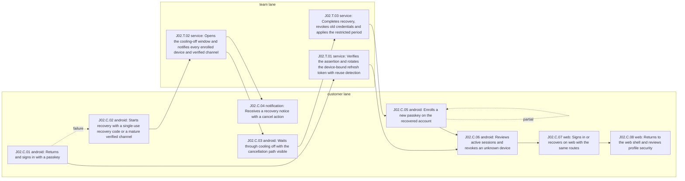

| Step | Lane | Channel | System | Actor | Action | Flow | Screens | Data | Authorization | Events | Policies | Signal |
|---|---|---|---|---|---|---|---|---|---|---|---|---|
| J02.C.01 | customer | android | android-app | Customer (provisional persona) | Returns and signs in with a passkey | F-AND-02 | S-AND-004 | confidential | Passkey assertion with user verification | none | ADR-019 | abandonment |
| J02.T.01 | team | service | api-identity | Identity service in the core API | Verifies the assertion and rotates the device-bound refresh token with reuse detection | none | none | restricted | Passkey assertion; DPoP-bound refresh token | none | ADR-019 | none |
| J02.C.02 | customer | android | android-app | Customer (provisional persona) | Starts recovery with a single-use recovery code or a mature verified channel | F-AND-02 | S-AND-006 | confidential | Unauthenticated recovery request | none | ADR-019 | none |
| J02.T.02 | team | service | api-identity | Identity service in the core API | Opens the cooling-off window and notifies every enrolled device and verified channel | none | none | restricted | Recovery route check; no session issued | none | ADR-019 | escalation |
| J02.C.03 | customer | android | android-app | Customer (provisional persona) | Waits through cooling off with the cancellation path visible | F-AND-02 | S-AND-007 | confidential | Recovery request holder; no account data | none | none | none |
| J02.C.04 | customer | notification | notification-outbox | Account owner on every enrolled device | Receives a recovery notice with a cancel action | none | none | internal | Delivery to enrolled devices and verified channels only | none | none | none |
| J02.T.03 | team | service | api-identity | Identity service in the core API | Completes recovery, revokes old credentials and applies the restricted period | none | none | restricted | Cooling off elapsed without cancellation | none | ADR-019 | none |
| J02.C.05 | customer | android | android-app | Customer (provisional persona) | Enrolls a new passkey on the recovered account | F-AND-02 | S-AND-008 | confidential | Recovered session in its restricted period | none | none | recovery |
| J02.C.06 | customer | android | android-app | Customer (provisional persona) | Reviews active sessions and revokes an unknown device | F-AND-02 | S-AND-064 | confidential | Signed-in owner on a device-bound session with ADR-019 step-up bound to the device removed | none | ADR-019 | none |
| J02.C.07 | customer | web | web-app | Customer (provisional persona) | Signs in or recovers on web with the same routes | F-WEB-01 | S-WEB-001, S-WEB-002 | confidential | Passkey assertion on the web origin | none | ADR-019 | none |
| J02.C.08 | customer | web | web-app | Customer (provisional persona) | Returns to the web shell and reviews profile security | F-WEB-01 | S-WEB-003, S-WEB-044 | confidential | Signed-in owner on a device-bound session | none | none | completion |

| Step | Branch | To | Recovery | Recovery owner |
|---|---|---|---|---|
| J02.C.01 | failure | J02.C.02 | A lost or unusable passkey routes to recovery entry | customer |
| J02.C.01 | offline | terminal | Offline sign-in keeps server data locked; retry when connected | customer |
| J02.T.01 | revocation | terminal | Token reuse revokes the whole token family; every session signs in again | identity_team |
| J02.T.01 | timeout | terminal | No session is issued until verification completes; the customer retries sign-in | identity_team |
| J02.T.02 | escalation | terminal | A request that fits neither route goes to support identity review without bypassing cooling off | support_operator |
| J02.C.04 | rollback | terminal | The owner cancels; the recovery is voided and any session it created is revoked | identity_team |
| J02.T.03 | permission_denied | terminal | High-risk actions are denied during the restricted period with its end time shown | identity_team |
| J02.C.05 | partial | J02.C.05 | Interrupted re-enrollment resumes; the old credential stays revoked | identity_team |

| Receiving step | Authoritative service | Receiving surface may show |
|---|---|---|
| J02.C.03 | api-identity | Recovery status and the remaining cooling-off window only |
| J02.C.04 | api-identity | That a recovery started and how to cancel it; no account or financial data |
| J02.C.05 | api-identity | Re-enrollment prompt and the restricted-period notice |
| J02.C.06 | api-identity | Sessions by device label and last-use time; no tokens or key material |
| J02.C.07 | api-identity | Sign-in and recovery state only; financial data loads after verification |

| Abuse path | Step | Actor | Threat | Safe failure |
|---|---|---|---|---|
| AB-J02-01 | J02.C.02 | Attacker holding a hijacked phone number or mailbox | Account takeover through channel reverification | Only a mature verified channel qualifies; cooling off and all-device notices let the owner cancel, and the restricted period blocks high-risk actions |
| AB-J02-02 | J02.T.01 | Holder of a copied refresh token | Replays a stolen refresh token from another device | Tokens are bound to the device key and reuse revokes the whole token family |

| Not applicable | Kind | Reason |
|---|---|---|
| signal | correction | Authentication changes no financial record; session revocation is counted as recovery |

### BP-J03 Capture to trusted corrected transaction

- Journey J03, customer audience; personas P03, P04 (provisional, pending:PenniLogic/docs#66).
- Flows: F-AND-03, F-AND-06, F-AND-07, F-AND-08, F-WEB-02, F-WEB-05. Diagrams: D01, D03, D04, D21. Policy class: none.
- Success: A captured, entered or imported transaction becomes a confirmed ledger transaction with provenance that the customer can correct on Android or web.
- Failure recovery: Unparsed, duplicate, conflicting or rejected items land in clarification with coded reasons; corrections post new entries and rules roll back without rewriting history.
- Metric: pending:PenniLogic/docs#77
- Current map (planned_baseline): Planned baseline from product/08 section 9.1: on-device capture, sync and clarification are drawn as one sequence for Android only.
- Target map (supersedes BP-J03.current_map): Capture, manual entry, receipts and statement import share one confirmation and correction path across Android and web, and raw message text never leaves the device.

Moments of truth:

- J03.T.01: Raw message text is parsed and discarded on the device; only structured fields move.
- J03.C.06: A correction or rule shows its effect before it is applied and can be rolled back.

```mermaid
flowchart LR
    subgraph customer[customer lane]
        J03_C_01["J03.C.01 android: Grants or declines optional message and notification access"]
        J03_C_02["J03.C.02 android: Reviews capture health and the clarification inbox and compares candidates"]
        J03_C_03["J03.C.03 android: Enters a transaction manually or manages accounts and categories"]
        J03_C_04["J03.C.04 android: Captures a receipt or connects a mailbox and confirms the extracted fields"]
        J03_C_05["J03.C.05 android: Sees the confirmed transaction with provenance in the timeline"]
        J03_C_06["J03.C.06 android: Corrects, reclassifies or creates a rule and previews its effect"]
        J03_C_07["J03.C.07 web: Resolves clarifications and manages rules on web"]
        J03_C_08["J03.C.08 web: Bulk edits transactions and maps a statement for import"]
        J03_C_09["J03.C.09 web: Sees corrected and imported transactions as confirmed"]
    end
    subgraph team[team lane]
        J03_T_01["J03.T.01 service: Parses message text locally, discards the raw content and emits a structured candidate with confidence"]
        J03_T_02["J03.T.02 service: Accepts the queued structured mutation idempotently and answers accepted, duplicate, conflict or denied"]
        J03_T_03["J03.T.03 service: Posts the confirmed transaction as balanced append-only entries with its provenance"]
        J03_T_04["J03.T.04 service: Applies the resolution as reversing and new entries; rules apply prospectively"]
        J03_T_05["J03.T.05 service: Validates mapped rows, de-duplicates them and commits only after preview"]
    end
    J03_C_01 --> J03_T_01
    J03_C_01 --> J03_C_04
    J03_C_01 -. permission_denied .-> J03_C_03
    J03_T_01 --> J03_C_02
    J03_T_01 -. failure .-> J03_C_02
    J03_C_02 --> J03_T_02
    J03_C_03 --> J03_T_02
    J03_C_04 --> J03_T_02
    J03_T_02 --> J03_T_03
    J03_T_02 -. partial .-> J03_C_02
    J03_T_03 --> J03_C_05
    J03_C_05 --> J03_C_06
    J03_C_06 --> J03_T_04
    J03_T_04 --> J03_C_07
    J03_T_04 -. rollback .-> J03_C_07
    J03_C_07 --> J03_C_08
    J03_C_08 --> J03_T_05
    J03_T_05 --> J03_C_09
    J03_T_05 -. partial .-> J03_C_08
```

| Step | Lane | Channel | System | Actor | Action | Flow | Screens | Data | Authorization | Events | Policies | Signal |
|---|---|---|---|---|---|---|---|---|---|---|---|---|
| J03.C.01 | customer | android | android-app | Customer (provisional persona) | Grants or declines optional message and notification access | F-AND-03 | S-AND-011, S-AND-012, S-AND-013 | confidential | Signed-in owner on a device-bound session | none | ADR-004, ADR-011 | none |
| J03.T.01 | team | service | android-capture | On-device capture component | Parses message text locally, discards the raw content and emits a structured candidate with confidence | none | none | restricted | Runs on the owner device only; no network path for raw text | none | ADR-003, ADR-004 | none |
| J03.C.02 | customer | android | android-app | Customer (provisional persona) | Reviews capture health and the clarification inbox and compares candidates | F-AND-07 | S-AND-028, S-AND-029, S-AND-030, S-AND-065 | confidential | Signed-in owner on a device-bound session | none | none | recovery |
| J03.C.03 | customer | android | android-app | Customer (provisional persona) | Enters a transaction manually or manages accounts and categories | F-AND-06 | S-AND-023, S-AND-024, S-AND-025 | confidential | Signed-in owner on a device-bound session | none | none | none |
| J03.C.04 | customer | android | android-app | Customer (provisional persona) | Captures a receipt or connects a mailbox and confirms the extracted fields | F-AND-08 | S-AND-032, S-AND-033, S-AND-034 | confidential | Signed-in owner on a device-bound session | none | ADR-004 | abandonment |
| J03.T.02 | team | service | api-sync | Sync endpoint in the core API | Accepts the queued structured mutation idempotently and answers accepted, duplicate, conflict or denied | none | none | confidential | Device-bound session; tenancy-isolated write | pending:PenniLogic/contracts#4, pending:PenniLogic/contracts#6 | ADR-010, ADR-015, ADR-018 | none |
| J03.T.03 | team | service | api-ledger | Ledger in the core API | Posts the confirmed transaction as balanced append-only entries with its provenance | none | none | confidential | Server-side posting for the owner only | pending:PenniLogic/contracts#19 | ADR-001, ADR-002, ADR-016, ADR-017 | none |
| J03.C.05 | customer | android | android-app | Customer (provisional persona) | Sees the confirmed transaction with provenance in the timeline | F-AND-06 | S-AND-021, S-AND-022 | confidential | Signed-in owner on a device-bound session | none | none | completion |
| J03.C.06 | customer | android | android-app | Customer (provisional persona) | Corrects, reclassifies or creates a rule and previews its effect | F-AND-07 | S-AND-030, S-AND-031 | confidential | Signed-in owner on a device-bound session | none | none | correction |
| J03.T.04 | team | service | api-ledger | Ledger in the core API | Applies the resolution as reversing and new entries; rules apply prospectively | none | none | confidential | Server-side posting for the owner only | pending:PenniLogic/contracts#17 | ADR-002, ADR-016 | none |
| J03.C.07 | customer | web | web-app | Customer (provisional persona) | Resolves clarifications and manages rules on web | F-WEB-05 | S-WEB-015, S-WEB-016, S-WEB-045, S-WEB-046 | confidential | Signed-in owner on a device-bound session | none | none | none |
| J03.C.08 | customer | web | web-app | Customer (provisional persona) | Bulk edits transactions and maps a statement for import | F-WEB-02 | S-WEB-005, S-WEB-007, S-WEB-008 | confidential | Signed-in owner on a device-bound session | none | none | none |
| J03.T.05 | team | service | api-import | Statement import in the core API | Validates mapped rows, de-duplicates them and commits only after preview | none | none | confidential | Signed-in owner; tenancy-isolated write | pending:PenniLogic/contracts#13 | ADR-015, ADR-016 | none |
| J03.C.09 | customer | web | web-app | Customer (provisional persona) | Sees corrected and imported transactions as confirmed | F-WEB-02 | S-WEB-006 | confidential | Signed-in owner on a device-bound session | none | none | completion |

| Step | Branch | To | Recovery | Recovery owner |
|---|---|---|---|---|
| J03.C.01 | permission_denied | J03.C.03 | Declined access leaves manual entry and import fully usable | customer |
| J03.C.01 | revocation | terminal | Access revoked in system settings shows capture as paused while manual entry continues | customer |
| J03.T.01 | failure | J03.C.02 | An unparsed message becomes a needs-review item without its text leaving the device | capture_team |
| J03.C.02 | escalation | terminal | Persistent capture failure shows health guidance and a support entry | support_operator |
| J03.T.02 | offline | terminal | The mutation stays queued with its idempotency key and shows as pending | sync_team |
| J03.T.02 | partial | J03.C.02 | A duplicate or conflict opens clarification with candidates side by side | sync_team |
| J03.T.03 | failure | terminal | A rejected posting returns a coded reason and nothing is posted | ledger_team |
| J03.T.04 | rollback | J03.C.07 | A rule rollback restores prior categorisation through new entries and keeps history | ledger_team |
| J03.T.05 | partial | J03.C.08 | Rejected rows are listed with coded reasons; accepted rows commit once and re-import is idempotent | ingestion_team |
| J03.T.05 | timeout | terminal | A long import continues server-side and its result stays resumable | ingestion_team |

| Receiving step | Authoritative service | Receiving surface may show |
|---|---|---|
| J03.C.02 | android-capture | Structured candidate, confidence and provenance; never the raw message |
| J03.C.05 | api-ledger | Confirmed transaction, category and provenance as returned by the server |
| J03.C.07 | api-ledger | Clarification items and rule effects as structured fields; message text stays on the device |
| J03.C.08 | api-import | Rejected rows with coded reasons for remapping; accepted rows stay committed |
| J03.C.09 | api-import | Committed rows, rejected-row reasons and the import result |

| Abuse path | Step | Actor | Threat | Safe failure |
|---|---|---|---|---|
| AB-J03-01 | J03.T.01 | Sender of a crafted message | Spoofed bank message injects a fake transaction | Candidates stay in review until the owner confirms; nothing posts from capture alone |
| AB-J03-02 | J03.T.02 | Tampered client | Submits a mutation carrying raw message text | The server API has no field that can accept raw message content, so the request is rejected |

| Not applicable | Kind | Reason |
|---|---|---|
| signal | escalation | Capture escalation is a support request measured in J10 |

### BP-J04 Debt strategy and scenario decision

- Journey J04, customer audience; personas P01, P05 (provisional, pending:PenniLogic/docs#66).
- Flows: F-AND-04, F-AND-05, F-WEB-03, F-WEB-04. Diagrams: D01, D03, D21. Policy class: none.
- Success: The customer compares strategies, chooses one and sees the re-derived debt-free date on both platforms.
- Failure recovery: Incomplete debt terms are named and fixed in place; offline comparison stays read-only and stale-marked; a previous plan version can be restored.
- Metric: pending:PenniLogic/docs#77
- Current map (planned_baseline): Planned baseline: strategy, simulator and advanced scenario screens per platform, with derivation shown on web only.
- Target map (supersedes BP-J04.current_map): One decision journey where every figure is server-derived and explainable, and a chosen plan is versioned rather than overwritten.

Moments of truth:

- J04.C.03: The customer sees why one strategy beats another before committing to it.
- J04.C.07: The new debt-free date matches on Android and web.

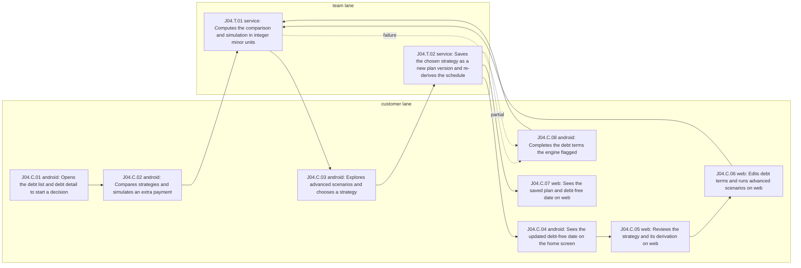

| Step | Lane | Channel | System | Actor | Action | Flow | Screens | Data | Authorization | Events | Policies | Signal |
|---|---|---|---|---|---|---|---|---|---|---|---|---|
| J04.C.01 | customer | android | android-app | Customer (provisional persona) | Opens the debt list and debt detail to start a decision | F-AND-04 | S-AND-015, S-AND-016 | confidential | Signed-in owner on a device-bound session | none | none | none |
| J04.C.02 | customer | android | android-app | Customer (provisional persona) | Compares strategies and simulates an extra payment | F-AND-05 | S-AND-018, S-AND-019 | confidential | Signed-in owner on a device-bound session | none | none | abandonment |
| J04.T.01 | team | service | api-debt-engine | Debt engine in the core API | Computes the comparison and simulation in integer minor units | none | none | confidential | Signed-in owner; default deny outside the caller tenancy | pending:PenniLogic/contracts#5 | ADR-001, ADR-015, ADR-017 | none |
| J04.C.03 | customer | android | android-app | Customer (provisional persona) | Explores advanced scenarios and chooses a strategy | F-AND-05 | S-AND-020 | confidential | Signed-in owner on a device-bound session | none | none | none |
| J04.T.02 | team | service | api-debt-engine | Debt engine in the core API | Saves the chosen strategy as a new plan version and re-derives the schedule | none | none | confidential | Signed-in owner of every debt in the plan | pending:PenniLogic/contracts#5 | ADR-015 | none |
| J04.C.04 | customer | android | android-app | Customer (provisional persona) | Sees the updated debt-free date on the home screen | F-AND-04 | S-AND-014 | confidential | Signed-in owner on a device-bound session | none | none | completion |
| J04.C.05 | customer | web | web-app | Customer (provisional persona) | Reviews the strategy and its derivation on web | F-WEB-03 | S-WEB-010, S-WEB-011, S-WEB-012 | confidential | Signed-in owner on a device-bound session | none | none | none |
| J04.C.06 | customer | web | web-app | Customer (provisional persona) | Edits debt terms and runs advanced scenarios on web | F-WEB-04 | S-WEB-013, S-WEB-014 | confidential | Signed-in owner on a device-bound session | none | none | correction |
| J04.C.07 | customer | web | web-app | Customer (provisional persona) | Sees the saved plan and debt-free date on web | F-WEB-03 | S-WEB-010 | confidential | Signed-in owner on a device-bound session | none | none | completion |
| J04.C.08 | customer | android | android-app | Customer (provisional persona) | Completes the debt terms the engine flagged | F-AND-04 | S-AND-017 | confidential | Signed-in owner on a device-bound session | none | none | recovery |

| Step | Branch | To | Recovery | Recovery owner |
|---|---|---|---|---|
| J04.C.02 | offline | terminal | Offline shows the last saved comparison as stale; no simulation runs on the device | customer |
| J04.T.01 | failure | J04.C.08 | Unsupported or missing terms return a coded reason naming the debt | debt_engine_team |
| J04.T.01 | permission_denied | terminal | A request for a debt outside the caller tenancy is refused and nothing is computed | security_team |
| J04.T.01 | timeout | terminal | A slow simulation is retried server-side; the previous result stays labelled stale | debt_engine_team |
| J04.T.02 | partial | J04.C.08 | A plan with an incomplete debt is marked partial until its terms are added | customer |
| J04.T.02 | rollback | terminal | The previous plan version can be restored; nothing is overwritten | debt_engine_team |

| Receiving step | Authoritative service | Receiving surface may show |
|---|---|---|
| J04.C.03 | api-debt-engine | Server-derived results with their inputs and as-of time; the client only formats them |
| J04.C.04 | api-debt-engine | Server-derived results with their inputs and as-of time; the client only formats them |
| J04.C.05 | api-debt-engine | Server-derived results with their inputs and as-of time; the client only formats them |
| J04.C.07 | api-debt-engine | Server-derived results with their inputs and as-of time; the client only formats them |
| J04.C.08 | api-debt-engine | Which debt lacks which term; no derived figures |

| Abuse path | Step | Actor | Threat | Safe failure |
|---|---|---|---|---|
| AB-J04-01 | J04.T.01 | Script calling the simulation endpoint | Probes another customer's debts through simulation requests | Ownership is checked before any computation and refusals carry no detail |
| AB-J04-02 | J04.C.06 | Tampered web client | Submits client-computed balances with edited terms | The engine ignores client totals and derives every figure from entries and terms |

| Not applicable | Kind | Reason |
|---|---|---|
| branch | revocation | A personal strategy involves no grant or consent that could be revoked |
| branch | escalation | Strategy choice has no operator involvement in the registry flows |
| signal | escalation | No operator escalation exists for a personal strategy decision |

### BP-J05 Income, budget, goal and net-worth planning

- Journey J05, customer audience; personas P01, P02, P05 (provisional, pending:PenniLogic/docs#66).
- Flows: F-AND-09, F-AND-10, F-AND-16, F-WEB-06, F-WEB-12. Diagrams: D01, D03, D21. Policy class: none.
- Success: The customer sets income, budgets and a goal and sees net worth and reports that agree on Android and web.
- Failure recovery: Missing income dates give a ranged result that names the gap; slow derivation shows the last confirmed values; a missing exchange rate shows per-currency totals only.
- Metric: pending:PenniLogic/docs#77
- Current map (planned_baseline): Planned baseline: income, budget, goal, net-worth and multi-currency screens are separate registry flows per platform.
- Target map (supersedes BP-J05.current_map): One planning journey where budgets, safe to spend, net worth and reporting-currency totals are derived on the server and stay per currency unless a dated rate exists.

Moments of truth:

- J05.C.02: Safe to spend reflects irregular income honestly instead of a false precise value.
- J05.C.07: Converted totals always show their rate source and date.

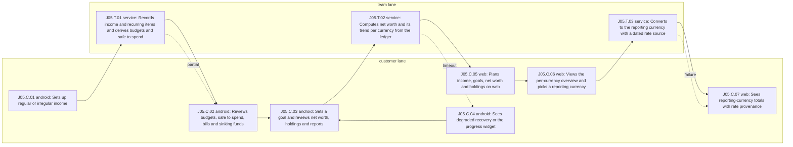

| Step | Lane | Channel | System | Actor | Action | Flow | Screens | Data | Authorization | Events | Policies | Signal |
|---|---|---|---|---|---|---|---|---|---|---|---|---|
| J05.C.01 | customer | android | android-app | Customer (provisional persona) | Sets up regular or irregular income | F-AND-09 | S-AND-035 | confidential | Signed-in owner on a device-bound session | none | none | abandonment |
| J05.T.01 | team | service | api-planning | Planning service in the core API | Records income and recurring items and derives budgets and safe to spend | none | none | confidential | Signed-in owner; tenancy-scoped query | pending:PenniLogic/contracts#12 | ADR-001, ADR-015, ADR-016 | none |
| J05.C.02 | customer | android | android-app | Customer (provisional persona) | Reviews budgets, safe to spend, bills and sinking funds | F-AND-09 | S-AND-036, S-AND-037 | confidential | Signed-in owner on a device-bound session | none | none | correction |
| J05.C.03 | customer | android | android-app | Customer (provisional persona) | Sets a goal and reviews net worth, holdings and reports | F-AND-10 | S-AND-038, S-AND-039, S-AND-040, S-AND-041 | confidential | Signed-in owner on a device-bound session | none | none | completion |
| J05.T.02 | team | service | api-net-worth | Net-worth service in the core API | Computes net worth and its trend per currency from the ledger | none | none | confidential | Signed-in owner; tenancy-scoped query | pending:PenniLogic/contracts#12 | ADR-010, ADR-017 | none |
| J05.C.04 | customer | android | android-app | Customer (provisional persona) | Sees degraded recovery or the progress widget | F-AND-16 | S-AND-059, S-AND-060 | confidential | Signed-in owner on a device-bound session | none | none | recovery |
| J05.C.05 | customer | web | web-app | Customer (provisional persona) | Plans income, goals, net worth and holdings on web | F-WEB-06 | S-WEB-017, S-WEB-018, S-WEB-019, S-WEB-020, S-WEB-021 | confidential | Signed-in owner on a device-bound session | none | none | none |
| J05.C.06 | customer | web | web-app | Customer (provisional persona) | Views the per-currency overview and picks a reporting currency | F-WEB-12 | S-WEB-038 | confidential | Signed-in owner on a device-bound session | none | none | none |
| J05.T.03 | team | service | api-net-worth | Net-worth service in the core API | Converts to the reporting currency with a dated rate source | none | none | confidential | Signed-in owner; tenancy-scoped query | pending:PenniLogic/contracts#9 | ADR-017 | none |
| J05.C.07 | customer | web | web-app | Customer (provisional persona) | Sees reporting-currency totals with rate provenance | F-WEB-12 | S-WEB-039 | confidential | Signed-in owner on a device-bound session | none | none | completion |

| Step | Branch | To | Recovery | Recovery owner |
|---|---|---|---|---|
| J05.T.01 | partial | J05.C.02 | Missing income dates give a ranged safe to spend with the gap named | planning_team |
| J05.T.01 | permission_denied | terminal | A query for another customer's plan is refused with no detail | security_team |
| J05.C.02 | offline | terminal | Offline budgets are read-only and stale-marked until the next sync | customer |
| J05.C.03 | rollback | terminal | A goal edit is undone by restoring its previous version; history is kept | planning_team |
| J05.T.02 | timeout | J05.C.04 | Slow derivation shows the degraded state with the last confirmed values | planning_team |
| J05.T.03 | failure | J05.C.07 | A missing rate shows per-currency totals only, never a partly converted sum | planning_team |

| Receiving step | Authoritative service | Receiving surface may show |
|---|---|---|
| J05.C.02 | api-planning | Server-derived budget and safe-to-spend values with their as-of time |
| J05.C.04 | api-net-worth | Last confirmed values marked stale with a retry |
| J05.C.05 | api-net-worth | Per-currency net worth and goal progress; no cross-currency sum on the client |
| J05.C.07 | api-net-worth | Converted totals with rate source and date, or per-currency totals |

| Abuse path | Step | Actor | Threat | Safe failure |
|---|---|---|---|---|
| AB-J05-01 | J05.T.01 | Tampered client | Submits a precomputed safe-to-spend or budget total | The server derives every budget figure from entries and ignores client totals |

| Not applicable | Kind | Reason |
|---|---|---|
| branch | revocation | Personal planning involves no grant; joint goals are revoked in J07 |
| branch | escalation | Personal planning has no operator path in the registry flows |
| signal | escalation | No operator escalation exists for personal planning |

### BP-J06 Split group from invite to settlement

- Journey J06, customer audience; personas P08 (provisional, pending:PenniLogic/docs#66).
- Flows: F-AND-11, F-WEB-07. Diagrams: D01, D03, D21. Policy class: sharing.
- Success: A group is created, invitees accept, expenses are allocated and every member settles to a zero balance.
- Failure recovery: Unsent or expired invites can be resent; partial settlements stay open and visible; disputes stay open until the organiser decides, with every change as a new entry.
- Metric: pending:PenniLogic/docs#77
- Current map (planned_baseline): Planned baseline: split group, allocation, settlement, dispute and invitation screens per platform with no shared clock or reversal model.
- Target map (supersedes BP-J06.current_map): One sharing journey with single-use invites, server-derived shares, append-only settlement history and a member exit that keeps the facts others depend on.

Moments of truth:

- J06.C.03: An invitee sees only the group and their own share before accepting.
- J06.C.04: Every member sees the same server-derived balance after a settlement.

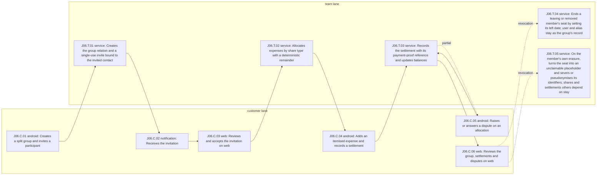

| Step | Lane | Channel | System | Actor | Action | Flow | Screens | Data | Authorization | Events | Policies | Signal |
|---|---|---|---|---|---|---|---|---|---|---|---|---|
| J06.C.01 | customer | android | android-app | Split organiser or participant (provisional persona) | Creates a split group and invites a participant | F-AND-11 | S-AND-042 | confidential | Signed-in owner on a device-bound session with ADR-019 step-up | none | ADR-019 | abandonment |
| J06.T.01 | team | service | api-sharing | Sharing service in the core API | Creates the group relation and a single-use invite bound to the invited contact | none | none | confidential | Organiser relation; default deny; ADR-019 step-up token verified at execution | pending:PenniLogic/contracts#8 | ADR-005, ADR-019 | none |
| J06.C.02 | customer | notification | notification-outbox | Invitee | Receives the invitation | none | none | internal | Delivery to the invited contact only | none | none | none |
| J06.C.03 | customer | web | web-app | Invitee, possibly not yet a customer | Reviews and accepts the invitation on web | F-WEB-07 | S-WEB-040 | confidential | Signed-in invitee holding the single-use invite, with ADR-019 step-up | none | ADR-019 | none |
| J06.T.02 | team | service | api-split-ledger | Split ledger in the core API | Allocates expenses by share type with a deterministic remainder | none | none | confidential | Member relation on the group | pending:PenniLogic/contracts#8 | ADR-001, ADR-005, ADR-015 | none |
| J06.C.04 | customer | android | android-app | Split organiser or participant (provisional persona) | Adds an itemised expense and records a settlement | F-AND-11 | S-AND-043, S-AND-044 | confidential | Member relation on the group | none | none | completion |
| J06.T.03 | team | service | api-split-ledger | Split ledger in the core API | Records the settlement with its payment-proof reference and updates balances | none | none | confidential | Member relation on the group | pending:PenniLogic/contracts#8 | ADR-002, ADR-015 | none |
| J06.C.05 | customer | android | android-app | Split organiser or participant (provisional persona) | Raises or answers a dispute on an allocation | F-AND-11 | S-AND-045 | confidential | Member relation on the group | none | none | correction |
| J06.C.06 | customer | web | web-app | Split organiser or participant (provisional persona) | Reviews the group, settlements and disputes on web | F-WEB-07 | S-WEB-022, S-WEB-023, S-WEB-024 | confidential | Member relation on the group | none | none | completion |
| J06.T.04 | team | service | api-split-ledger | Split ledger in the core API | Ends a leaving or removed member's seat by setting its left date; user and alias stay as the group's record | none | none | confidential | The leaving member, or an authorised member per the T-SPL-03 authorization matrix | pending:PenniLogic/contracts#8 | ADR-006, ADR-021 | none |
| J06.T.05 | team | service | api-split-ledger | Split ledger in the core API | On the member's own erasure, turns the seat into an unclaimable placeholder and severs or pseudonymises its identifiers; shares and settlements others depend on stay | none | none | confidential | Erasure job for the member's own validated rights request, made under ADR-019 step-up | pending:PenniLogic/contracts#8 | ADR-006, ADR-019, ADR-021 | none |

| Step | Branch | To | Recovery | Recovery owner |
|---|---|---|---|---|
| J06.T.01 | failure | terminal | An invite that cannot be sent shows as not sent and can be retried | sharing_team |
| J06.C.02 | timeout | terminal | An unanswered invite expires and the organiser can resend it | sharing_team |
| J06.C.03 | permission_denied | terminal | A declined or mismatched invite keeps the person out of the group | sharing_team |
| J06.T.02 | offline | terminal | An expense added offline syncs idempotently; balances refresh only from the server | sync_team |
| J06.T.03 | partial | J06.C.05 | A partial settlement leaves the rest open and visible to both members | sharing_team |
| J06.C.05 | escalation | terminal | An unresolved dispute stays open for the organiser to decide; no operator sees member finances | sharing_team |
| J06.C.06 | revocation | J06.T.04 | A member leaves or is removed and their access ends within the published online revocation bound | sharing_team |
| J06.C.06 | revocation | J06.T.05 | A member's own erasure request ends the seat as an unclaimable placeholder, the strongest revocation of ADR-021 | privacy_team |
| J06.T.04 | rollback | terminal | A removal made in error is recovered only by a fresh invite and acceptance; the ended seat keeps its user and alias as the group's record | sharing_team |
| J06.T.05 | partial | terminal | Descriptions the member authored are redacted while every balance stays identical for the remaining members | privacy_team |

| Receiving step | Authoritative service | Receiving surface may show |
|---|---|---|
| J06.C.02 | api-sharing | Organiser display name and group name only; no amounts or balances |
| J06.C.03 | api-sharing | Group name, accepted members and the invitee's own pending share only |
| J06.C.04 | api-split-ledger | Each member's server-derived share and balance; no client-side remainder arithmetic |
| J06.C.05 | api-split-ledger | The disputed item, both positions and its status |
| J06.C.06 | api-split-ledger | Server-derived balances and settlement history |

| Step | Clock | Audit | Notification | Reversal |
|---|---|---|---|---|
| J06.T.02 | Settlement and dispute windows are set by the sharing contract owner; values pending | Every allocation, settlement and dispute is an append-only split ledger entry | Members affected by an allocation, settlement or dispute are notified | Corrections post reversing split entries; settled history is never rewritten |
| J06.T.03 | Settlement and dispute windows are set by the sharing contract owner; values pending | Every allocation, settlement and dispute is an append-only split ledger entry | Members affected by an allocation, settlement or dispute are notified | Corrections post reversing split entries; settled history is never rewritten |
| J06.T.04 | Access ends within the published online revocation bound of T-CON-04; value pending | The membership end is journaled and audited as an append-only event | Quiet by design: no notification describes the leave or removal, per ADR-021 section 2.2 | Leaving does not erase: user and alias stay until the member's own erasure; rejoining needs a fresh invite and acceptance |
| J06.T.05 | Erasure follows the rights clock owned by the compliance pack; value pending | The erasure is journaled in the erasure register and audited as append-only events | No notification describes the erasure; counterparties see the seat as a former member | Cancellable until the shred phase starts, as in J10; afterwards the placeholder is final and can never be claimed |

| Abuse path | Step | Actor | Threat | Safe failure |
|---|---|---|---|---|
| AB-J06-01 | J06.C.03 | Person who obtained a forwarded invite | Joins a group they were not invited to | Invites are single-use and bound to the invited contact, and acceptance requires sign-in |
| AB-J06-02 | J06.T.02 | Member acting in bad faith | Inflates another member's share | Affected members are notified, can dispute, and settlement history is append-only |

| Not applicable | Kind | Reason |
|---|---|---|
| signal | recovery | Split recovery happens through disputes and reversing entries, counted as correction |
| signal | escalation | Split disputes are resolved between members; the registry has no operator split flow |

### BP-J07 Household grant, joint goal and safe exit

- Journey J07, customer audience; personas P06, P07 (provisional, pending:PenniLogic/docs#66).
- Flows: F-AND-12, F-WEB-08. Diagrams: D01, D03, D21. Policy class: sharing.
- Success: A household shares only the aggregates each member granted, tracks a joint goal, and any member can leave safely at any time.
- Failure recovery: Declined or expired invites share nothing; after revocation server reads stop within the published online bound and cached data is evicted by the offline lease bound; safe exit needs no one else's approval.
- Metric: pending:PenniLogic/docs#77
- Current map (planned_baseline): Planned baseline from product/08 section 9.2: the household grant state machine from private to revoked and evicted, without channel or service ownership.
- Target map (supersedes BP-J07.current_map): The same state machine as a cross-channel blueprint with explicit aggregate and detail consents, an access log, safe exit and a server-enforced eviction path.

Moments of truth:

- J07.C.02: The member sees exactly what would be shared before anything is shared.
- J07.C.05: Leaving needs no one else's approval, runs as one step-up request and is quiet by design.

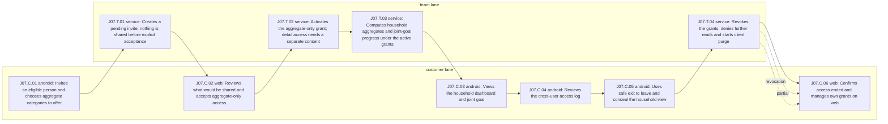

| Step | Lane | Channel | System | Actor | Action | Flow | Screens | Data | Authorization | Events | Policies | Signal |
|---|---|---|---|---|---|---|---|---|---|---|---|---|
| J07.C.01 | customer | android | android-app | Household owner (provisional persona) | Invites an eligible person and chooses aggregate categories to offer | F-AND-12 | S-AND-046 | confidential | Signed-in owner on a device-bound session with ADR-019 step-up | none | ADR-019 | abandonment |
| J07.T.01 | team | service | api-sharing | Sharing service in the core API | Creates a pending invite; nothing is shared before explicit acceptance | none | none | confidential | Owner relation; default deny; ADR-019 step-up token verified at execution | pending:PenniLogic/contracts#8 | ADR-005, ADR-019 | none |
| J07.C.02 | customer | web | web-app | Household member (provisional persona) | Reviews what would be shared and accepts aggregate-only access | F-WEB-08 | S-WEB-041 | confidential | Signed-in invitee holding the invite, with ADR-019 step-up | none | ADR-019 | none |
| J07.T.02 | team | service | api-sharing | Sharing service in the core API | Activates the aggregate-only grant; detail access needs a separate consent | none | none | confidential | Member acceptance recorded per category and level; ADR-019 step-up token verified at execution | pending:PenniLogic/contracts#8 | ADR-005, ADR-018, ADR-019, ADR-021 | none |
| J07.T.03 | team | service | api-household | Household service in the core API | Computes household aggregates and joint-goal progress under the active grants | none | none | confidential | Server-mediated read under the grant predicate | pending:PenniLogic/contracts#8 | ADR-005, ADR-021 | none |
| J07.C.03 | customer | android | android-app | Household owner or member | Views the household dashboard and joint goal | F-AND-12 | S-AND-047 | confidential | Active grant for each shared category | none | none | completion |
| J07.C.04 | customer | android | android-app | Household member (provisional persona) | Reviews the cross-user access log | F-AND-12 | S-AND-048 | confidential | Signed-in owner on a device-bound session | none | none | none |
| J07.C.05 | customer | android | android-app | Household member (provisional persona) | Uses safe exit to leave and conceal the household view | F-AND-12 | S-AND-049 | confidential | Signed-in member on a device-bound session with ADR-019 step-up | none | ADR-019, ADR-021 | none |
| J07.T.04 | team | service | api-sharing | Sharing service in the core API | Revokes the grants, denies further reads and starts client purge | none | none | restricted | Unilateral revocation by either party in one request under ADR-019 step-up | pending:PenniLogic/contracts#8 | ADR-005, ADR-019, ADR-021 | none |
| J07.C.06 | customer | web | web-app | Former household member | Confirms access ended and manages own grants on web | F-WEB-08 | S-WEB-025, S-WEB-026, S-WEB-027 | confidential | Signed-in owner on a device-bound session; each grant change needs ADR-019 step-up | none | ADR-019 | none |

| Step | Branch | To | Recovery | Recovery owner |
|---|---|---|---|---|
| J07.T.01 | failure | terminal | An undelivered invite shows as not sent and nothing is shared | sharing_team |
| J07.T.01 | timeout | terminal | An unanswered invite expires and nothing is shared | sharing_team |
| J07.C.02 | permission_denied | terminal | Declining keeps both people private; the owner sees declined or expired only | sharing_team |
| J07.T.02 | rollback | terminal | Detail consent can be withdrawn back to aggregate-only at any time | sharing_team |
| J07.T.03 | offline | terminal | Offline views use a short lease; when it expires cached shared data is hidden | sharing_team |
| J07.C.05 | escalation | terminal | A member at risk is pointed to support without revealing the household to the other person | support_operator |
| J07.T.04 | partial | J07.C.06 | A device still holding shared data purges it at next contact or lease expiry | sharing_team |
| J07.T.04 | revocation | J07.C.06 | Every grant in both directions ends; server reads stop within the published online revocation bound | sharing_team |

| Receiving step | Authoritative service | Receiving surface may show |
|---|---|---|
| J07.C.02 | api-sharing | Who offers which categories at which detail level; no financial values |
| J07.C.03 | api-household | Aggregates the active grants admit; never descriptions without a detail grant |
| J07.C.06 | api-sharing | Own grants and their revoked state only; no former household data |

| Step | Clock | Audit | Notification | Reversal |
|---|---|---|---|---|
| J07.T.01 | Invite expiry and the online and offline revocation bounds are published by the sharing contract owner; values pending | Every grant change is audited and detail reads are visible to the data owner | Both people are told when a grant is offered or accepted; a narrowing or revocation sends nothing beyond a content-free pointer, per ADR-021 section 2.1 | Revocation is unilateral and takes effect within the published online revocation bound; sharing again needs a new invite |
| J07.T.02 | Invite expiry and the online and offline revocation bounds are published by the sharing contract owner; values pending | Every grant change is audited and detail reads are visible to the data owner | Both people are told when a grant is offered or accepted; a narrowing or revocation sends nothing beyond a content-free pointer, per ADR-021 section 2.1 | Revocation is unilateral and takes effect within the published online revocation bound; sharing again needs a new invite |
| J07.T.04 | Server reads stop within the published online revocation bound and cached copies within the offline lease bound; both values are pending on the sharing contract | The exit is audited and visible to the member who left | Quiet by design: no notification describes the exit and nothing beyond a content-free pointer is sent; whether the other person sees any pointer is a pending design decision | A revoked grant is never restored; sharing again needs a new invite and acceptance |

| Abuse path | Step | Actor | Threat | Safe failure |
|---|---|---|---|---|
| AB-J07-01 | J07.C.01 | Coercive household owner | Pressures a member into granting detail access | Detail access needs the member's separate consent, shows in the access log and ends with safe exit |
| AB-J07-02 | J07.C.03 | Household owner | Tries to read a member's transactions through the dashboard | Only granted aggregates are returned; detail reads need a detail grant and are logged |
| AB-J07-03 | J07.C.05 | Person sharing the member's device | Discovers that the member used safe exit | Safe exit conceals the household view and emits no journey signal |
| AB-J07-04 | J07.T.04 | Revoked grantee with a cached copy | Keeps reading shared data offline | Server reads stop within the published online revocation bound and the cached copy is evicted at next contact or when the offline lease bound elapses |

| Not applicable | Kind | Reason |
|---|---|---|
| signal | correction | A grant journey corrects no financial record |
| signal | escalation | Safe exit emits no journey signal so its use cannot be inferred |
| signal | recovery | The confirmation reached only after safe exit emits no signal, so safe exit cannot be inferred from it |

### BP-J08 Assistant explanation and controlled action

- Journey J08, customer audience; personas P09 (provisional, pending:PenniLogic/docs#66).
- Flows: F-AND-13, F-WEB-09. Diagrams: D01, D03, D21. Policy class: none.
- Success: The customer gets a cited explanation and, if they choose, confirms a draft that posts as a normal transaction with AI provenance.
- Failure recovery: Quota, provider or tool failures refuse explicitly with a retry or plan path; a posted draft is reversed like any transaction; history can be turned off or erased.
- Metric: pending:PenniLogic/docs#77
- Current map (planned_baseline): Planned baseline: assistant answer, draft and history screens per platform with the AI egress path decided in ADR-022 but not drawn as a journey.
- Target map (supersedes BP-J08.current_map): One assistant journey where scope comes from the server session, every remote call leaves through the egress proxy and nothing posts without the customer's confirmation.

Moments of truth:

- J08.C.02: Figures in an answer come from the customer's own records, with citations.
- J08.C.03: Nothing is posted until the customer confirms the draft.

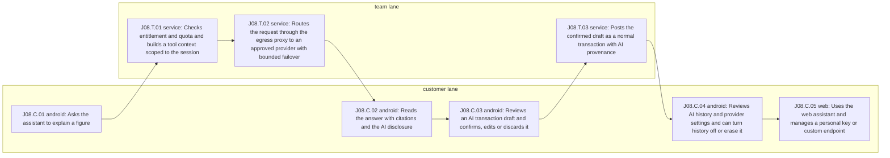

| Step | Lane | Channel | System | Actor | Action | Flow | Screens | Data | Authorization | Events | Policies | Signal |
|---|---|---|---|---|---|---|---|---|---|---|---|---|
| J08.C.01 | customer | android | android-app | AI-assisted customer (provisional persona) | Asks the assistant to explain a figure | F-AND-13 | S-AND-050 | confidential | Signed-in owner on a device-bound session | none | none | abandonment |
| J08.T.01 | team | service | api-ai-tools | AI tool layer in the core API | Checks entitlement and quota and builds a tool context scoped to the session | none | none | confidential | Signed-in owner; scope derived on the server | pending:PenniLogic/contracts#10 | ADR-022, ADR-023, ADR-025 | none |
| J08.T.02 | team | service | ai-gateway | AI gateway | Routes the request through the egress proxy to an approved provider with bounded failover | none | none | confidential | Authenticated core API caller with a virtual key | none | ADR-022 | recovery |
| J08.C.02 | customer | android | android-app | AI-assisted customer (provisional persona) | Reads the answer with citations and the AI disclosure | F-AND-13 | S-AND-050 | confidential | Signed-in owner on a device-bound session | none | none | completion |
| J08.C.03 | customer | android | android-app | AI-assisted customer (provisional persona) | Reviews an AI transaction draft and confirms, edits or discards it | F-AND-13 | S-AND-051 | confidential | Signed-in owner on a device-bound session | none | none | correction |
| J08.T.03 | team | service | api-ledger | Ledger in the core API | Posts the confirmed draft as a normal transaction with AI provenance | none | none | confidential | Owner confirmation of the draft | pending:PenniLogic/contracts#20 | ADR-002, ADR-016 | none |
| J08.C.04 | customer | android | android-app | AI-assisted customer (provisional persona) | Reviews AI history and provider settings and can turn history off or erase it | F-AND-13 | S-AND-052 | confidential | Signed-in owner on a device-bound session | pending:PenniLogic/contracts#18 | none | none |
| J08.C.05 | customer | web | web-app | AI-assisted customer (provisional persona) | Uses the web assistant and manages a personal key or custom endpoint | F-WEB-09 | S-WEB-028, S-WEB-029, S-WEB-030 | confidential | Signed-in owner on a device-bound session; adding or replacing a key or endpoint needs ADR-019 step-up | none | ADR-019 | completion |

| Step | Branch | To | Recovery | Recovery owner |
|---|---|---|---|---|
| J08.C.01 | offline | terminal | Offline, the assistant says it is unavailable and the rest of the app works | customer |
| J08.T.01 | permission_denied | terminal | Quota or entitlement denial explains the limit and the plan path | billing_team |
| J08.T.02 | timeout | terminal | A provider timeout returns a refusal with retry; no partial answer is shown as complete | ai_platform_team |
| J08.T.02 | failure | terminal | A provider outage fails over within the approved set or refuses | ai_platform_team |
| J08.C.03 | partial | terminal | A draft missing a required field cannot be confirmed until completed | customer |
| J08.T.03 | rollback | terminal | A posted draft is reversed like any transaction, by a reversing entry | ledger_team |
| J08.C.04 | revocation | terminal | Turning history off or erasing it removes stored conversations | ai_platform_team |

| Receiving step | Authoritative service | Receiving surface may show |
|---|---|---|
| J08.C.02 | api-ai-tools | Answer text with citations to server records and the disclosure; figures come from tools, not the model |
| J08.C.04 | api-ledger | The posted transaction with AI provenance and own history items |
| J08.C.05 | api-ai-tools | Provider choice and key status; a stored key is never shown back |

| Abuse path | Step | Actor | Threat | Safe failure |
|---|---|---|---|---|
| AB-J08-01 | J08.T.01 | Text planted in a merchant name or note | Prompt injection tries to act on another customer's data | Tool scope is derived on the server from the session, never from model output |
| AB-J08-02 | J08.C.05 | Customer configuring a custom endpoint | Points the endpoint at an internal address | Every remote AI call leaves through the egress proxy to approved destinations only |

| Not applicable | Kind | Reason |
|---|---|---|
| branch | escalation | The registry assistant flows have no human escalation; refusals are terminal |
| signal | escalation | No operator escalation exists in the assistant flows |

### BP-J09 Subscription, notification and retention control

- Journey J09, customer audience; personas P01, P02, P09 (provisional, pending:PenniLogic/docs#66).
- Flows: F-AND-14, F-WEB-10. Diagrams: D01, D03, D21. Policy class: billing.
- Success: The customer buys or changes a plan, sees the server-resolved entitlement and controls which notices and digests they receive.
- Failure recovery: Unverified purchases grant nothing and stay pending; undeliverable notices retry without duplicates; cancellations can be undone before the period boundary.
- Metric: pending:PenniLogic/docs#77
- Current map (planned_baseline): Planned baseline: purchase, preference, retention and billing portal screens per platform with entitlement rules in ADR-007 and ADR-023.
- Target map (supersedes BP-J09.current_map): One billing and messaging journey where entitlement is resolved only on the server against a pinned plan version and every notice respects the customer's preferences.

Moments of truth:

- J09.C.02: The plan and quota shown are exactly what the server will enforce.
- J09.C.06: The customer sees when a change takes effect before it does.

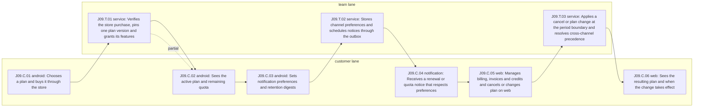

| Step | Lane | Channel | System | Actor | Action | Flow | Screens | Data | Authorization | Events | Policies | Signal |
|---|---|---|---|---|---|---|---|---|---|---|---|---|
| J09.C.01 | customer | android | android-app | Customer (provisional persona) | Chooses a plan and buys it through the store | F-AND-14 | S-AND-053 | confidential | Signed-in owner on a device-bound session | none | none | abandonment |
| J09.T.01 | team | service | api-entitlements | Entitlement service in the core API | Verifies the store purchase, pins one plan version and grants its features | none | none | confidential | Server-side purchase verification | pending:PenniLogic/contracts#7 | ADR-007, ADR-023 | none |
| J09.C.02 | customer | android | android-app | Customer (provisional persona) | Sees the active plan and remaining quota | F-AND-14 | S-AND-053 | confidential | Signed-in owner on a device-bound session | none | none | completion |
| J09.C.03 | customer | android | android-app | Customer (provisional persona) | Sets notification preferences and retention digests | F-AND-14 | S-AND-054, S-AND-055 | confidential | Signed-in owner on a device-bound session | none | none | none |
| J09.T.02 | team | service | api-messaging | Messaging preferences in the core API | Stores channel preferences and schedules notices through the outbox | none | none | confidential | Signed-in owner | pending:PenniLogic/contracts#15 | none | none |
| J09.C.04 | customer | notification | notification-outbox | Customer (provisional persona) | Receives a renewal or quota notice that respects preferences | none | none | internal | Delivery to the owner's enabled channels only | none | none | none |
| J09.C.05 | customer | web | web-app | Customer (provisional persona) | Manages billing, invoices and credits and cancels or changes plan on web | F-WEB-10 | S-WEB-031, S-WEB-032, S-WEB-033 | confidential | Signed-in owner on a device-bound session | none | none | correction |
| J09.T.03 | team | service | api-entitlements | Entitlement service in the core API | Applies a cancel or plan change at the period boundary and resolves cross-channel precedence | none | none | confidential | Signed-in owner | pending:PenniLogic/contracts#7 | ADR-007, ADR-023 | none |
| J09.C.06 | customer | web | web-app | Customer (provisional persona) | Sees the resulting plan and when the change takes effect | F-WEB-10 | S-WEB-031 | confidential | Signed-in owner on a device-bound session | none | none | completion |

| Step | Branch | To | Recovery | Recovery owner |
|---|---|---|---|---|
| J09.C.01 | offline | terminal | A purchase pending offline is confirmed when the store reports it; nothing unlocks before server verification | billing_team |
| J09.T.01 | failure | terminal | An unverified purchase grants nothing and shows pending with retry | billing_team |
| J09.T.01 | partial | J09.C.02 | A store notice arriving before client confirmation is processed idempotently and the state converges | billing_team |
| J09.C.02 | permission_denied | terminal | A feature outside the pinned plan version is denied by the server with the plan path shown | billing_team |
| J09.T.02 | revocation | terminal | Turning a channel off applies to the next send | messaging_team |
| J09.C.04 | timeout | terminal | An undeliverable notice is retried by the outbox and never duplicated | messaging_team |
| J09.T.03 | rollback | terminal | A cancellation can be undone before the period boundary | billing_team |
| J09.T.03 | escalation | terminal | Refund or dispute requests go to the billing operator queue in J10 | support_operator |

| Receiving step | Authoritative service | Receiving surface may show |
|---|---|---|
| J09.C.02 | api-entitlements | Plan version, features and remaining quota as resolved by the server |
| J09.C.04 | api-entitlements | Plan name, renewal timing and quota state; no transactions |
| J09.C.05 | api-entitlements | Plan, invoices and credit notes as recorded by the server |
| J09.C.06 | api-entitlements | Resulting plan version and its effective boundary |

| Step | Clock | Audit | Notification | Reversal |
|---|---|---|---|---|
| J09.T.01 | Renewal, grace and refund windows follow the store and the pinned plan version; values pending | Every entitlement change is recorded in the usage ledger and the audit trail | The customer is told of purchase, renewal, failure and plan change | Refunds and chargebacks unwind entitlement and quota through the billing operator flow |
| J09.T.03 | Renewal, grace and refund windows follow the store and the pinned plan version; values pending | Every entitlement change is recorded in the usage ledger and the audit trail | The customer is told of purchase, renewal, failure and plan change | Refunds and chargebacks unwind entitlement and quota through the billing operator flow |

| Abuse path | Step | Actor | Threat | Safe failure |
|---|---|---|---|---|
| AB-J09-01 | J09.T.01 | Customer replaying a purchase token | Reuses one purchase to unlock several accounts | Purchases are verified on the server and bound to one account; client entitlement claims are ignored |
| AB-J09-02 | J09.C.01 | Repeat trial seeker | Creates accounts to restart trials | Trial anti-abuse is enforced on the server, never in the client |

| Not applicable | Kind | Reason |
|---|---|---|
| signal | recovery | Payment recovery runs in the store and the billing operator flow, not in a customer step |
| signal | escalation | Refund escalation is measured in the J10 billing operator queue |

### BP-J10 Trust, rights and support

- Journey J10, customer audience; personas P03, P07, P10 (provisional, pending:PenniLogic/docs#66).
- Flows: F-AND-15, F-WEB-11, F-ADM-06, F-ADM-07. Diagrams: D01, D03, D05, D21. Policy class: rights.
- Success: A customer's export, deletion or support request is validated, fulfilled by a qualified operator on redacted data and closed with a notice inside its clock.
- Failure recovery: Every request is acknowledged and its clock runs from acknowledgement; an unverifiable request ends in a reasoned refusal; requests near breach are escalated; refusals carry reasons and a way to contest; shared records keep placeholder facts.
- Metric: pending:PenniLogic/docs#77
- Current map (planned_baseline): Planned baseline from product/08 section 9.3: rights request and operator fulfillment as one flow, with support and refunds in separate registry flows.
- Target map (supersedes BP-J10.current_map): One trust journey joining the customer trust centre, rights and support requests and the redacted operator queues, with clocks, audit, notices and reversal on every consequential step.

Moments of truth:

- J10.T.01: The response clock starts when the request is acknowledged, before any validation.
- J10.C.03: The customer always gets an outcome or a reasoned refusal.

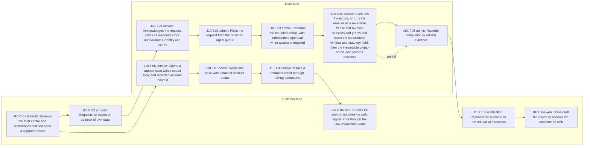

| Step | Lane | Channel | System | Actor | Action | Flow | Screens | Data | Authorization | Events | Policies | Signal |
|---|---|---|---|---|---|---|---|---|---|---|---|---|
| J10.C.01 | customer | android | android-app | Customer (provisional persona) | Reviews the trust centre and preferences and can open a support request | F-AND-15 | S-AND-056, S-AND-058, S-AND-063 | confidential | Signed-in owner on a device-bound session | none | none | none |
| J10.C.02 | customer | android | android-app | Customer (provisional persona) | Requests an export or deletion of own data | F-AND-15 | S-AND-057 | confidential | Signed-in owner on a device-bound session with ADR-019 step-up | none | ADR-006, ADR-019 | abandonment |
| J10.T.01 | team | service | api-rights | Rights service in the core API | Acknowledges the request, starts its response clock and validates identity and scope | none | none | restricted | Signed-in data principal with ADR-019 step-up; scope limited to own data | pending:PenniLogic/contracts#14 | ADR-006, ADR-019 | none |
| J10.T.02 | team | admin | admin-console | Support and privacy operator (provisional persona) | Picks the request from the redacted rights queue | F-ADM-07 | S-ADM-018 | confidential | Qualified operator role through the default-deny policy point; redacted by default | none | ADR-020 | none |
| J10.T.03 | team | admin | admin-console | Support and privacy operator (provisional persona) | Performs the bounded action, with independent approval when access is required | F-ADM-07 | S-ADM-019 | confidential | Qualified operator role through the default-deny policy point; redacted by default | none | ADR-020 | none |
| J10.T.04 | team | service | api-rights | Rights service in the core API | Executes the export, or runs the erasure as a reversible freeze that revokes sessions and grants and starts the cancellation window and statutory hold, then the irreversible crypto-shred, and records evidence | none | none | restricted | Approved rights action | pending:PenniLogic/contracts#14 | ADR-006, ADR-021 | none |
| J10.T.05 | team | admin | admin-console | Support and privacy operator (provisional persona) | Records completion or refusal evidence | F-ADM-07 | S-ADM-020 | confidential | Qualified operator role through the default-deny policy point; redacted by default | none | none | none |
| J10.C.03 | customer | notification | notification-outbox | Customer (provisional persona) | Receives the outcome or the refusal with reasons | none | none | internal | Delivery to the requesting account's channels only | none | none | none |
| J10.C.04 | customer | web | web-app | Customer (provisional persona) | Downloads the export or reviews the outcome on web | F-WEB-11 | S-WEB-034, S-WEB-035 | restricted | Signed-in owner on a device-bound session | none | none | completion |
| J10.T.06 | team | service | api-support | Support intake in the core API | Opens a support case with a coded topic and redacted account context | none | none | confidential | Signed-in owner or a verified unauthenticated ticket | pending:PenniLogic/contracts#15 | none | none |
| J10.T.07 | team | admin | admin-console | Support and privacy operator (provisional persona) | Works the case with redacted account status | F-ADM-06 | S-ADM-015, S-ADM-016 | confidential | Qualified operator role through the default-deny policy point; redacted by default | none | ADR-020 | escalation |
| J10.T.08 | team | admin | admin-console | Support and privacy operator (provisional persona) | Issues a refund or credit through billing operations | F-ADM-06 | S-ADM-017 | confidential | Qualified operator role through the default-deny policy point; redacted by default | pending:PenniLogic/contracts#7 | ADR-007, ADR-020, ADR-023 | none |
| J10.C.05 | customer | web | web-app | Customer (provisional persona) | Checks the support outcome on web, signed in or through the unauthenticated route | F-WEB-11 | S-WEB-036, S-WEB-037, S-WEB-043 | confidential | Signed-in owner or a verified ticket holder | none | none | completion |

| Step | Branch | To | Recovery | Recovery owner |
|---|---|---|---|---|
| J10.C.01 | offline | terminal | Settings show the last confirmed state; changes wait for a connection | customer |
| J10.C.01 | revocation | terminal | Withdrawing a purpose consent stops that processing and is recorded | privacy_team |
| J10.T.01 | failure | terminal | An unverifiable request ends in a refusal with a coded reason inside its running clock | rights_team |
| J10.T.02 | escalation | terminal | A request nearing its clock is escalated before breach | privacy_lead |
| J10.T.03 | permission_denied | terminal | Access beyond the redacted view without independent approval is denied | security_team |
| J10.T.04 | partial | J10.T.05 | Shared records keep placeholder facts others depend on; the response explains what was retained and why | rights_team |
| J10.T.04 | rollback | terminal | A cancellation before the shred records the erasure as cancelled; grants stay revoked and memberships ended until the person re-creates them | rights_team |
| J10.C.03 | timeout | terminal | An undeliverable notice is retried and the outcome stays in the trust centre | messaging_team |
| J10.T.06 | failure | terminal | An intake failure keeps the draft on the device and retries | support_team |
| J10.T.08 | rollback | terminal | A mistaken refund is corrected by a new audited entry | billing_team |

| Receiving step | Authoritative service | Receiving surface may show |
|---|---|---|
| J10.T.02 | api-rights | Redacted request, scope and clock; no customer financial detail |
| J10.T.05 | api-rights | Outcome and evidence references; no exported content |
| J10.C.03 | api-rights | Outcome and how to contest it; never exported data |
| J10.C.04 | api-rights | Own request status and an authenticated export download |
| J10.T.07 | api-support | Case, coded topic and redacted account status only |
| J10.C.05 | api-support | Own case status and outcome; the unauthenticated route shows status only for a verified ticket |

| Step | Clock | Audit | Notification | Reversal |
|---|---|---|---|---|
| J10.T.01 | The response clock starts at acknowledgement of every request or grievance, per T-CMP-01; its values come from the compliance floor profile and are pending | Every action on the request is one audited write | The customer is told of receipt, progress, completion or refusal with reasons | A refusal can be contested by a new request; an erasure can be cancelled with the same proof as intake from the freeze until the shred starts (ADR-021 Phase 1), and the shred is final by design |
| J10.T.03 | The response clock starts at acknowledgement of every request or grievance, per T-CMP-01; its values come from the compliance floor profile and are pending | Every action on the request is one audited write | The customer is told of receipt, progress, completion or refusal with reasons | A refusal can be contested by a new request; an erasure can be cancelled with the same proof as intake from the freeze until the shred starts (ADR-021 Phase 1), and the shred is final by design |
| J10.T.04 | The response clock starts at acknowledgement of every request or grievance, per T-CMP-01; its values come from the compliance floor profile and are pending | Every action on the request is one audited write | The customer is told of receipt, progress, completion or refusal with reasons | A refusal can be contested by a new request; an erasure can be cancelled with the same proof as intake from the freeze until the shred starts (ADR-021 Phase 1), and the shred is final by design |
| J10.T.08 | Refund windows follow the store and the pinned plan version; values pending | Every refund is one audited write and unwinds entitlement and quota | The customer is told of the refund and any plan change | A refund is reversed only by a new audited correction, never an edit |

| Abuse path | Step | Actor | Threat | Safe failure |
|---|---|---|---|---|
| AB-J10-01 | J10.T.03 | Curious or bribed operator | Uses a rights case to view customer financial detail | Detail access needs independent approval, is purpose-bound, expires and is audited |
| AB-J10-02 | J10.C.02 | Impersonator | Requests an export of someone else's data | The request needs ADR-019 step-up, identity and scope are validated, and the export is delivered only to the authenticated account |
| AB-J10-03 | J10.C.05 | Unauthenticated requester | Probes support status for other people's cases | Status needs a verified ticket and reveals no account data |

| Not applicable | Kind | Reason |
|---|---|---|
| signal | correction | Rights and support change no financial record directly |
| signal | recovery | Recovery from a refusal is a new request, counted as a fresh journey start |

### BP-J11 Operator access and compliance fulfillment

- Journey J11, operator audience; personas P10, P11 (provisional, pending:PenniLogic/docs#66).
- Flows: F-ADM-01, F-ADM-02, F-ADM-03, F-ADM-07, F-ADM-09. Diagrams: D01, D03, D05, D21. Policy class: rights.
- Success: Operators reach only the work their role allows, gain detail or production access only through independent, expiring approval, and close rights requests inside their clock.
- Failure recovery: Denied or expired requests grant nothing; break glass is reviewed after the fact; a restore that fails the scrub barrier is discarded; a leaver's revoked session is denied on its next request.
- Metric: pending:PenniLogic/docs#77
- Current map (planned_baseline): Planned baseline: operator sign-in, redaction and elevation, lifecycle, rights fulfillment and production access are separate admin flows under ADR-020.
- Target map (supersedes BP-J11.current_map): One operator journey from sign-in to fulfilled request where every access is purpose-bound, approved by someone else, expiring and audited before data is read.

Moments of truth:

- J11.T.04: No customer row is read before the audit record is durable.
- J11.T.05: The approver is never the requester.

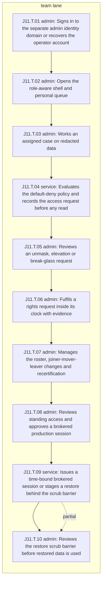

| Step | Lane | Channel | System | Actor | Action | Flow | Screens | Data | Authorization | Events | Policies | Signal |
|---|---|---|---|---|---|---|---|---|---|---|---|---|
| J11.T.01 | team | admin | admin-console | Support and privacy operator (provisional persona) | Signs in to the separate admin identity domain or recovers the operator account | F-ADM-01 | S-ADM-001, S-ADM-030 | confidential | Separate admin identity domain | none | ADR-020 | abandonment |
| J11.T.02 | team | admin | admin-console | Support and privacy operator (provisional persona) | Opens the role-aware shell and personal queue | F-ADM-01 | S-ADM-002, S-ADM-003 | confidential | Qualified operator role through the default-deny policy point; redacted by default | none | none | none |
| J11.T.03 | team | admin | admin-console | Support and privacy operator (provisional persona) | Works an assigned case on redacted data | F-ADM-02 | S-ADM-004 | confidential | Qualified operator role through the default-deny policy point; redacted by default | none | none | none |
| J11.T.04 | team | service | admin-api | Admin API | Evaluates the default-deny policy and records the access request before any read | none | none | restricted | Admin role through audited definer functions only | pending:PenniLogic/contracts#11 | ADR-020 | none |
| J11.T.05 | team | admin | admin-console | Security and compliance approver (provisional persona) | Reviews an unmask, elevation or break-glass request | F-ADM-02 | S-ADM-005, S-ADM-006 | confidential | Approver distinct from the requester | none | ADR-020 | escalation |
| J11.T.06 | team | admin | admin-console | Support and privacy operator (provisional persona) | Fulfils a rights request inside its clock with evidence | F-ADM-07 | S-ADM-018, S-ADM-019, S-ADM-020 | confidential | Qualified operator role through the default-deny policy point; redacted by default | pending:PenniLogic/contracts#14 | none | completion |
| J11.T.07 | team | admin | admin-console | Security and compliance approver (provisional persona) | Manages the roster, joiner-mover-leaver changes and recertification | F-ADM-03 | S-ADM-007, S-ADM-008, S-ADM-009 | confidential | Qualified operator role through the default-deny policy point; redacted by default | none | none | none |
| J11.T.08 | team | admin | admin-console | Security and compliance approver (provisional persona) | Reviews standing access and approves a brokered production session | F-ADM-09 | S-ADM-024, S-ADM-025 | confidential | Qualified operator role through the default-deny policy point; redacted by default | none | none | none |
| J11.T.09 | team | service | access-broker | Production access broker | Issues a time-bound brokered session or stages a restore behind the scrub barrier | none | none | restricted | Approved broker request | none | ADR-020 | none |
| J11.T.10 | team | admin | admin-console | Security and compliance approver (provisional persona) | Reviews the restore scrub barrier before restored data is used | F-ADM-09 | S-ADM-026 | confidential | Qualified operator role through the default-deny policy point; redacted by default | none | none | completion |

| Step | Branch | To | Recovery | Recovery owner |
|---|---|---|---|---|
| J11.T.01 | failure | terminal | A failed sign-in issues no session; operator recovery follows its own audited route | security_team |
| J11.T.04 | permission_denied | terminal | A missing capability or approval returns deny with no data | security_team |
| J11.T.05 | escalation | terminal | Break glass is reviewed after the fact by a second approver | compliance_lead |
| J11.T.05 | timeout | terminal | An unapproved request expires and grants nothing | security_team |
| J11.T.07 | revocation | terminal | A leaver's access is revoked and open elevations end | security_team |
| J11.T.09 | partial | J11.T.10 | A restore stopped at the scrub barrier stays unusable until reviewed | platform_team |
| J11.T.10 | rollback | terminal | A restore that fails review is discarded and the barrier stays closed | platform_team |

| Receiving step | Authoritative service | Receiving surface may show |
|---|---|---|
| J11.T.05 | admin-api | Purpose, scope, requester and expiry; no customer data before approval |
| J11.T.10 | access-broker | Restore scope and scrub results; no customer records |

| Step | Clock | Audit | Notification | Reversal |
|---|---|---|---|---|
| J11.T.04 | Elevation, unmask and break-glass limits are the ADR-020 section 16 values; the expiry of an unapproved request is pending | One transactional audit write per action before any data leaves the database | Requester and approver are notified of each decision | Elevation ends at its ADR-020 section 16 limit or on revocation and the next request is denied; access already used is reported, never hidden |
| J11.T.05 | Elevation, unmask and break-glass limits are the ADR-020 section 16 values; the expiry of an unapproved request is pending | One transactional audit write per action before any data leaves the database | Requester and approver are notified of each decision | Elevation ends at its ADR-020 section 16 limit or on revocation and the next request is denied; access already used is reported, never hidden |
| J11.T.06 | The response clock starts at acknowledgement of every request or grievance, per T-CMP-01; its values come from the compliance floor profile and are pending | Every action on the request is one audited write | The customer is told of receipt, progress, completion or refusal with reasons | A refusal can be contested by a new request; an erasure can be cancelled with the same proof as intake from the freeze until the shred starts (ADR-021 Phase 1), and the shred is final by design |

| Abuse path | Step | Actor | Threat | Safe failure |
|---|---|---|---|---|
| AB-J11-01 | J11.T.05 | Requester colluding through a second account | Self-approves an unmask | Requester and approver must be different qualified people, and both decisions are audited |
| AB-J11-02 | J11.T.03 | Operator looking for a known person | Searches for a customer without a case | There is no browse-all-users destination; access starts from an assigned case |
| AB-J11-03 | J11.T.08 | Engineer with standing access | Keeps production access beyond need | Standing access is inventoried and sessions are brokered and time-bound |

| Not applicable | Kind | Reason |
|---|---|---|
| branch | offline | Administrative actions are online only; the console has no offline mode |
| signal | correction | Operators correct no customer financial record in this journey |
| signal | recovery | Operator recovery is an audited security route, not a journey signal |

### BP-J12 System configuration, audit and release operations

- Journey J12, operator audience; personas P11, P12 (provisional, pending:PenniLogic/docs#66).
- Flows: F-ADM-04, F-ADM-05, F-ADM-08, F-ADM-10. Diagrams: D01, D03, D21. Policy class: billing.
- Success: Plan, provider and spend changes reach customers without silent impact, and audit, incident and release evidence is complete before release.
- Failure recovery: Invalid plan versions are never published; migrations are reversible until their boundary; the kill switch refuses new remote AI calls at admission and stops in-flight traffic within the ADR-022 60-second bound; a failed retest blocks release.
- Metric: pending:PenniLogic/docs#77
- Current map (planned_baseline): Planned baseline: plan, AI provider, audit and incident admin flows as separate registry entries with no customer-facing consequence drawn.
- Target map (supersedes BP-J12.current_map): One configuration and release journey where every change is versioned, audited and visible to the customers it affects before it takes effect.

Moments of truth:

- J12.C.01: Customers hear about a plan migration before it takes effect.
- J12.T.06: A broken audit chain or anomaly always opens an incident.

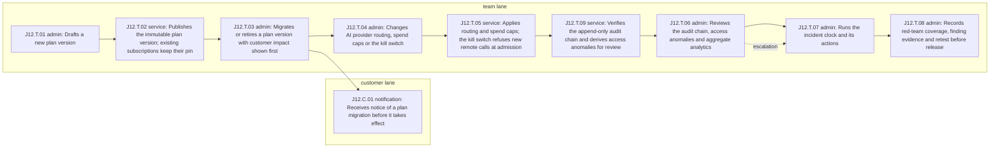

| Step | Lane | Channel | System | Actor | Action | Flow | Screens | Data | Authorization | Events | Policies | Signal |
|---|---|---|---|---|---|---|---|---|---|---|---|---|
| J12.T.01 | team | admin | admin-console | Billing and AI operations manager (provisional persona) | Drafts a new plan version | F-ADM-04 | S-ADM-010, S-ADM-011 | internal | Qualified operator role through the default-deny policy point; redacted by default | none | ADR-023 | abandonment |
| J12.T.02 | team | service | api-entitlements | Entitlement service in the core API | Publishes the immutable plan version; existing subscriptions keep their pin | none | none | internal | Approved plan change | pending:PenniLogic/contracts#7 | ADR-007, ADR-023 | none |
| J12.T.03 | team | admin | admin-console | Billing and AI operations manager (provisional persona) | Migrates or retires a plan version with customer impact shown first | F-ADM-04 | S-ADM-012 | internal | Qualified operator role through the default-deny policy point; redacted by default | none | none | none |
| J12.C.01 | customer | notification | notification-outbox | Affected customer | Receives notice of a plan migration before it takes effect | none | none | internal | Delivery to affected subscribers only | none | none | none |
| J12.T.04 | team | admin | admin-console | Billing and AI operations manager (provisional persona) | Changes AI provider routing, spend caps or the kill switch | F-ADM-05 | S-ADM-013, S-ADM-014 | internal | Qualified operator role through the default-deny policy point; redacted by default | none | ADR-022 | none |
| J12.T.05 | team | service | ai-gateway | AI gateway | Applies routing and spend caps; the kill switch refuses new remote calls at admission | none | none | internal | Approved operations change | none | ADR-022 | none |
| J12.T.09 | team | service | audit-trail | Audit trail service | Verifies the append-only audit chain and derives access anomalies for review | none | none | confidential | Append-only audit writer; chain reads by the verification job | none | ADR-020 | none |
| J12.T.06 | team | admin | admin-console | Security and compliance approver (provisional persona) | Reviews the audit chain, access anomalies and aggregate analytics | F-ADM-08 | S-ADM-021, S-ADM-022, S-ADM-023 | confidential | Security reviewer role; aggregates only | none | ADR-020 | escalation |
| J12.T.07 | team | admin | admin-console | Security and compliance approver (provisional persona) | Runs the incident clock and its actions | F-ADM-10 | S-ADM-029 | confidential | Qualified operator role through the default-deny policy point; redacted by default | none | none | none |
| J12.T.08 | team | admin | admin-console | Security and compliance approver (provisional persona) | Records red-team coverage, finding evidence and retest before release | F-ADM-10 | S-ADM-027, S-ADM-028 | confidential | Qualified operator role through the default-deny policy point; redacted by default | none | none | completion |

| Step | Branch | To | Recovery | Recovery owner |
|---|---|---|---|---|
| J12.T.01 | permission_denied | terminal | A change outside the operator's role is not addressable | security_team |
| J12.T.02 | failure | terminal | A plan version that fails validation is never published | billing_team |
| J12.T.03 | rollback | terminal | A migration is reversible until its effective boundary | billing_team |
| J12.T.04 | revocation | terminal | A revoked provider key or approval is refused at admission for every new request | ai_platform_team |
| J12.T.05 | partial | terminal | In-flight traffic is terminated within the ADR-022 60-second bound; no new request bypasses the new cap | ai_platform_team |
| J12.T.09 | failure | terminal | A chain that fails verification is flagged and surfaces at the next review | security_team |
| J12.T.06 | escalation | J12.T.07 | An anomaly or broken chain opens an incident | security_team |
| J12.T.07 | timeout | terminal | A notice deadline at risk is escalated to the compliance owner | compliance_lead |
| J12.T.08 | failure | terminal | A failed retest blocks release until it is fixed | security_team |

| Receiving step | Authoritative service | Receiving surface may show |
|---|---|---|
| J12.T.03 | api-entitlements | Counts of affected subscriptions by plan version; no customer identities |
| J12.C.01 | api-entitlements | The plan change and its effective boundary; no other customer data |
| J12.T.06 | audit-trail | Chain verification results and anomaly alerts; analytics are aggregates only |

| Step | Clock | Audit | Notification | Reversal |
|---|---|---|---|---|
| J12.T.03 | Advance notice before a price or entitlement change takes effect, per obligation O-21; the notice period is pending on T-BIL-10 | Every migration is one audited change naming the source and target plan versions | Affected customers are told before the change takes effect | A migration is reversible until its effective boundary; untouched subscriptions keep their pinned version |

| Abuse path | Step | Actor | Threat | Safe failure |
|---|---|---|---|---|
| AB-J12-01 | J12.T.04 | Operator under cost pressure | Routes traffic to an unapproved provider | Only approved destinations are routable through the egress proxy and every change is audited |
| AB-J12-02 | J12.T.06 | Insider with audit access | Tampers with audit records to hide an access | The audit chain is tamper-evident and write-once |
| AB-J12-03 | J12.T.03 | Product operator | Silently moves customers to a worse plan | Subscriptions keep their pinned version and migrations show impact and notify customers first |

| Not applicable | Kind | Reason |
|---|---|---|
| branch | offline | Administrative actions are online only; the console has no offline mode |
| signal | correction | Configuration changes correct no customer financial record |
| signal | recovery | Incident recovery is tracked on the incident clock, not as a journey signal |

## Reopen index

A change to a system, an event owner or a policy reopens only the blueprints listed for it.

| Kind | Reference | Blueprints |
|---|---|---|
| system | access-broker | BP-J11 |
| system | admin-api | BP-J11 |
| system | admin-console | BP-J10, BP-J11, BP-J12 |
| system | ai-gateway | BP-J08, BP-J12 |
| system | android-app | BP-J01, BP-J02, BP-J03, BP-J04, BP-J05, BP-J06, BP-J07, BP-J08, BP-J09, BP-J10 |
| system | android-capture | BP-J03 |
| system | api-ai-tools | BP-J08 |
| system | api-consent | BP-J01 |
| system | api-debt-engine | BP-J01, BP-J04 |
| system | api-entitlements | BP-J09, BP-J12 |
| system | api-household | BP-J07 |
| system | api-identity | BP-J01, BP-J02 |
| system | api-import | BP-J03 |
| system | api-ledger | BP-J03, BP-J08 |
| system | api-messaging | BP-J09 |
| system | api-net-worth | BP-J05 |
| system | api-planning | BP-J05 |
| system | api-rights | BP-J10 |
| system | api-sharing | BP-J06, BP-J07 |
| system | api-split-ledger | BP-J06 |
| system | api-support | BP-J10 |
| system | api-sync | BP-J03 |
| system | audit-trail | BP-J12 |
| system | notification-outbox | BP-J02, BP-J06, BP-J09, BP-J10, BP-J12 |
| system | web-app | BP-J01, BP-J02, BP-J03, BP-J04, BP-J05, BP-J06, BP-J07, BP-J08, BP-J09, BP-J10 |
| event | pending:PenniLogic/contracts#10 | BP-J08 |
| event | pending:PenniLogic/contracts#11 | BP-J11 |
| event | pending:PenniLogic/contracts#12 | BP-J05 |
| event | pending:PenniLogic/contracts#13 | BP-J03 |
| event | pending:PenniLogic/contracts#14 | BP-J01, BP-J10, BP-J11 |
| event | pending:PenniLogic/contracts#15 | BP-J09, BP-J10 |
| event | pending:PenniLogic/contracts#17 | BP-J03 |
| event | pending:PenniLogic/contracts#18 | BP-J08 |
| event | pending:PenniLogic/contracts#19 | BP-J03 |
| event | pending:PenniLogic/contracts#20 | BP-J08 |
| event | pending:PenniLogic/contracts#4 | BP-J03 |
| event | pending:PenniLogic/contracts#5 | BP-J01, BP-J04 |
| event | pending:PenniLogic/contracts#6 | BP-J03 |
| event | pending:PenniLogic/contracts#7 | BP-J09, BP-J10, BP-J12 |
| event | pending:PenniLogic/contracts#8 | BP-J06, BP-J07 |
| event | pending:PenniLogic/contracts#9 | BP-J05 |
| policy | ADR-001 | BP-J01, BP-J03, BP-J04, BP-J05, BP-J06 |
| policy | ADR-002 | BP-J03, BP-J06, BP-J08 |
| policy | ADR-003 | BP-J03 |
| policy | ADR-004 | BP-J01, BP-J03 |
| policy | ADR-005 | BP-J06, BP-J07 |
| policy | ADR-006 | BP-J06, BP-J10 |
| policy | ADR-007 | BP-J09, BP-J10, BP-J12 |
| policy | ADR-010 | BP-J01, BP-J03, BP-J05 |
| policy | ADR-011 | BP-J01, BP-J03 |
| policy | ADR-015 | BP-J01, BP-J03, BP-J04, BP-J05, BP-J06 |
| policy | ADR-016 | BP-J03, BP-J05, BP-J08 |
| policy | ADR-017 | BP-J01, BP-J03, BP-J04, BP-J05 |
| policy | ADR-018 | BP-J03, BP-J07 |
| policy | ADR-019 | BP-J01, BP-J02, BP-J06, BP-J07, BP-J08, BP-J10 |
| policy | ADR-020 | BP-J10, BP-J11, BP-J12 |
| policy | ADR-021 | BP-J06, BP-J07, BP-J10 |
| policy | ADR-022 | BP-J08, BP-J12 |
| policy | ADR-023 | BP-J08, BP-J09, BP-J10, BP-J12 |
| policy | ADR-025 | BP-J08 |

## Journey gaps

| Gap | Journey | Step | Category | Owner | Backlog item | Status | Summary |
|---|---|---|---|---|---|---|---|
| GAP-J01-01 | J01 | J01.T.01 | contract_event | PenniLogic/api#57 | none | open | No published contract names account, recovery or session lifecycle events, so the J01 identity step carries no event reference yet. |
| GAP-J01-02 | J01 | none | contract_event | PenniLogic/api#82 | none | open | Journey signals have no published analytics event schema; the content-free field set in these blueprints is a proposal for the ingestion owner. |
| GAP-J01-03 | J01 | none | registry_content | PenniLogic/docs#75 | none | open | Registry diagrams D01, D03, D04, D05 and D21 name product/08 or Figma pages as their artifact, but their renderings are the Git text in product/journey-blueprints.md while Figma is held; docs#75 owns repointing artifact_path. |
| GAP-J02-01 | J02 | J02.T.02 | contract_event | PenniLogic/api#57 | none | open | Recovery start, cancellation and completion have no published event, so the J02 recovery steps carry no event reference yet. |
| GAP-J02-02 | J02 | J02.C.04 | registry_content | PenniLogic/docs#75 | none | open | The registry has no notification or email channel flow or screen, so notification steps in J02, J06, J09, J10 and J12 map to no flow. |
| GAP-J03-01 | J03 | none | registry_content | PenniLogic/docs#75 | none | open | Stories US-WEB-02 and US-WEB-05 on flows F-WEB-02 and F-WEB-05 name persona P05, but journey J03 lists only P03 and P04; the blueprint copies the journey list until docs#75 adds P05 to J03 or moves the stories, and docs#66 validates the persona. |
| GAP-J05-01 | J05 | J05.T.03 | policy | PenniLogic/contracts#9 | none | open | Reporting-currency conversion needs currencies beyond the single-currency MVP ledger of ADR-017; admission and rate source are pending. |
| GAP-J06-01 | J06 | J06.T.02 | policy | PenniLogic/contracts#8 | none | open | Settlement and dispute windows for split groups have no published value, so the J06 clock controls state them as pending. |
| GAP-J07-01 | J07 | J07.T.04 | policy | PenniLogic/docs#96 | none | open | ADR-021 makes safe exit quiet by design with no notification content beyond a pointer; whether the other member sees any pointer after a safe exit, and its wording, is an open design decision. |
| GAP-J07-02 | J07 | J07.T.03 | policy | PenniLogic/contracts#8 | none | open | The online revocation bound and the offline lease bound after which cached shared household data is hidden are both published by T-CON-04 and have no value yet. |
| GAP-J07-03 | J07 | none | research | PenniLogic/docs#66 | none | open | Safe-exit and coercive-control assumptions are unvalidated; research must not recruit both household members into one session. |
| GAP-J09-01 | J09 | J09.T.03 | registry_content | PenniLogic/docs#75 | none | open | J09 lists no operator refund flow; refund operations F-ADM-06 belong to J10 only, so billing reversal relies on the J10 operator step. |
| GAP-J10-01 | J10 | J10.T.01 | policy | PenniLogic/docs#44 | none | open | Response clock values for export, deletion and grievance requests are not published in an accepted source; T-CMP-01 starts each clock at acknowledgement, and controls state the values as pending. |
| GAP-J10-02 | J10 | J10.T.08 | registry_content | PenniLogic/docs#75 | none | open | Story US-ADM-06 on refund flow F-ADM-06 names persona P12, but journey J10 lists only P03, P07 and P10, so the refund step names the support operator; docs#75 owns adding P12 to J10 and docs#66 validates the persona. |
| GAP-J10-03 | J10 | none | policy | PenniLogic/docs#44 | none | open | Every step carries a data class on a four-level scale (public, internal, confidential, restricted) proposed here; ADR-020 section 15 assigns personal-data classification to the T-CMP-04 jurisdiction profile, which confirms or replaces the scale. |
| GAP-J11-01 | J11 | J11.T.04 | policy | PenniLogic/api#47 | none | open | ADR-020 section 16 sets elevation, unmask and break-glass limits but no expiry for an unapproved access request; J11 states it as pending. |
| GAP-J11-02 | J11 | none | registry_content | PenniLogic/docs#75 | none | open | The docs#67 scope names operator blueprints for refunds, provider change and incidents, but the registry assigns those flows to J10 and J12, not J11. |
| GAP-J12-01 | J12 | J12.T.07 | policy | PenniLogic/docs#44 | none | open | Regulator and customer notice deadlines for incidents are not published in an accepted source; the incident clock step cannot state them. |
| GAP-J12-02 | J12 | J12.T.03 | policy | PenniLogic/api#60 | none | open | Obligation O-21 requires advance notice and grandfathering on a price or entitlement change, but no accepted source publishes the notice period, so the J12 migration clock states it as pending. |
